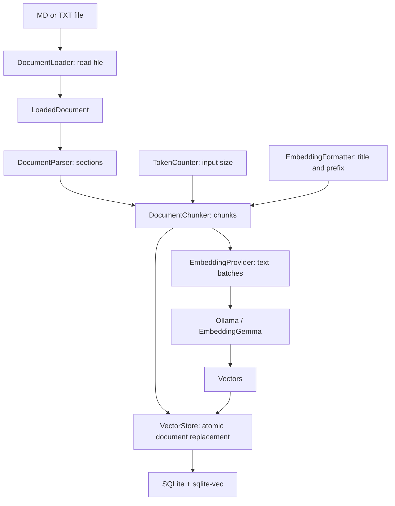
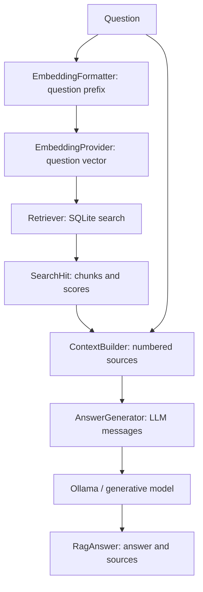

# Local RAG

English | [Russian](README.ru.md)

Local RAG ingests Markdown and TXT documents, retrieves relevant chunks, and answers questions using those chunks. Computation runs on your computer: **Ollama + EmbeddingGemma** produces embeddings, **Tokenizers.js** counts tokens, **SQLite + sqlite-vec** stores the index, and a separate LLM in Ollama generates answers.

This is an educational TypeScript CLI project. Each stage has an interface so its implementation can be replaced. The package and project directory are named `local-rag`; the display name is **Local RAG**. CLI messages, sample documents, and generated answers use English by default.

## Contents

- [Quick start](#quick-start)
- [Commands](#commands)
- [How RAG works](#how-rag-works)
- [Stage interfaces](#stage-interfaces)
- [Replacing a component](#replacing-a-component)
- [Configuration](#configuration)
- [Local data](#local-data)
- [Project structure](#project-structure)
- [Development and validation](#development-and-validation)
- [Dependencies and tools](#dependencies-and-tools)
- [Files stored in Git](#files-stored-in-git)
- [Limitations and troubleshooting](#limitations-and-troubleshooting)

## Quick start

Install **Node.js 24+** and [Ollama](https://ollama.com/download). Open the Ollama application, or run `ollama serve` in a separate terminal.

Run these commands from the `local-rag` project directory:

```bash
yarn install --immutable
cp .env.example .env
yarn setup
ollama pull qwen3.5:4b
yarn check
yarn ingest examples/company.md
yarn ingest examples/it.txt
yarn search "How far in advance must employees on probation request leave?"
yarn ask "How far in advance must employees on probation request leave?"
```

If `.env` already exists, edit it instead of overwriting it. The sample policies are fictional. The expected answer to this question is **21 calendar days**.

`yarn setup` downloads two tokenizer files from a pinned Hugging Face revision and pulls EmbeddingGemma into Ollama if the model is missing. Download the answer model separately. Once preparation is complete, `ingest`, `search`, and `ask` use local files and the local service without internet access. Ollama must remain running.

Yarn **4.18.1** is pinned, and its executable is included in `.yarn/releases`. You can use Corepack: `corepack yarn install --immutable`. If neither `yarn` nor Corepack is available, invoke the bundled executable:

```bash
node .yarn/releases/yarn-4.18.1.cjs install --immutable
node .yarn/releases/yarn-4.18.1.cjs setup
```

## Commands

| Command                           | Purpose                                                                               |
| --------------------------------- | ------------------------------------------------------------------------------------- |
| `yarn setup`                      | Prepare the tokenizer and EmbeddingGemma; may download files                          |
| `yarn check`                      | Check SQLite in memory, tokenizer files, both models, and an actual embedding request |
| `yarn check --storage-only`       | Check SQLite and its extension without Ollama                                         |
| `yarn ingest "path/document.md"`  | Ingest or completely replace one document in the index                                |
| `yarn ingest "path/document.txt"` | Do the same for plain text                                                            |
| `yarn search "question"`          | Show the nearest chunks and similarity scores                                         |
| `yarn ask "question"`             | Retrieve chunks and generate an answer with source references                         |
| `yarn cli --help`                 | Show command help                                                                     |

`check` does not index documents or assess LLM answer quality. It uses a temporary in-memory SQLite database. Compatibility of the working index is checked when running `ingest`, `search`, or `ask`.

## How RAG works

RAG has two processes: **document indexing** and **answering a question**. Indexing prepares documents in advance. When a question arrives, the application retrieves relevant text and passes it to the generative model.

### Indexing



#### 1. Loading a file

`FileDocumentLoader` in `src/documents/file-loader.ts` accepts a path, checks the extension and size, reads UTF-8, and normalizes line endings. Supported extensions are `.md`, `.markdown`, and `.txt`.

It returns a `LoadedDocument` containing the identifier, physical path, name, format, text, and content hash. The identifier is a hash of the physical path, so reingestion updates the same document. Moving or renaming the file creates a different document identifier.

#### 2. Parsing sections

`TextDocumentParser` in `src/documents/parser.ts` uses a Markdown AST from remark. It preserves heading hierarchy, ignores `#` headings inside code blocks, and keeps introductory text without a heading. TXT is treated as a single plain-text section.

Reference definitions are preserved: required definitions are appended to sections that use them, while unused definitions are stored in a `References` section.

The result is a `DocumentSection[]` containing each section's title, text, and source line range. This stage does not generate vectors or call Ollama.

#### 3. Tokenization and chunking

A token is a unit of text processed by a model: a word, part of a word, punctuation, or another segment. Character counts and token counts are different.

`HuggingFaceTokenCounter` in `src/tokenization/huggingface-tokenizer.ts` uses **@huggingface/tokenizers** and EmbeddingGemma tokenizer files. Counting runs locally without embedding weights or ONNX Runtime. `count(text)` returns the number of tokens, including special tokens defined by the tokenizer configuration.

`TokenDocumentChunker` in `src/chunking/token-chunker.ts` implements splitting directly. Sections stay separate. The module fits chunks against the token count of the complete formatted model input, prefers paragraph, line, or whitespace boundaries, and preserves Unicode graphemes using `Intl.Segmenter`. Individual word lengths are not added together because token counts can depend on surrounding text. Chunk text is also bounded by a character limit.

Each `DocumentChunk` contains the original chunk body, section title, section line range, prepared `embeddingInput`, token count, and position. EmbeddingGemma input is limited to 2048 tokens. The application reserves a small safety margin and uses `truncate: false` to prevent silent truncation.

Overlap preserves context across chunk boundaries but increases the number of vectors. It is bounded by the configured token count and half the previous chunk, so splitting always makes progress. Large tables and code blocks may benefit from a different chunking implementation.

The application tokenizer counts input for chunk sizing; it does not produce vectors. Ollama tokenizes the input again before embedding, and the provider compares Ollama's reported token count with the local count. Ollama uses the answer model's own tokenizer during generation.

#### 4. Formatting embedding inputs

`EmbeddingGemmaFormatter` in `src/embeddings/formatter.ts` prepares different inputs for documents and questions:

```text
Document: title: company.md — Company policy → Leave | text: Chunk text...
Question: task: search result | query: Who approves leave?
```

This is the [retrieval format recommended by Google](https://ai.google.dev/gemma/docs/embeddinggemma/model_card#prompt-instructions). The title and prefix count toward the token budget. The original `body` is stored separately and is passed to the answer model without the embedding prefix.

Formatting has a separate interface because another model may require different prefixes. Its `signature` is included in the index fingerprint. An implementation that changes input preparation must report a different signature.

#### 5. Embeddings

`OllamaEmbeddingProvider` in `src/embeddings/ollama-embedder.ts` calls the official client's `embed()` method. The client communicates over HTTP with the running local Ollama service.

By default, EmbeddingGemma converts each prepared input into a vector of 768 numbers. Documents and questions use the same embedding model with different input formats. The provider checks input limits, result count, dimensions, finite values, and nonzero vectors. It verifies the model family and embedding capability, compares batch token counts with Ollama, and checks the model digest before and after each request. A detected model change fails the operation before the document is written.

Chunks are sent in configurable batches. All vectors for a document are computed before the SQLite write begins. If embedding fails, the previous document remains in the database.

#### 6. Storage

`SqliteVectorStore` in `src/storage/sqlite-store.ts` implements `VectorStore` and stores:

| Table           | Data                                                      |
| --------------- | --------------------------------------------------------- |
| `documents`     | Document identifier, path, name, and version              |
| `chunks`        | Original bodies, embedding inputs, sections, and metadata |
| `chunk_vectors` | Float32 vectors searched by cosine distance               |
| `rag_meta`      | Embedding configuration fingerprint and dimensions        |

Old chunks are removed and new chunks inserted in one transaction. SQL errors trigger rollback. Reingestion does not accumulate duplicates. Unrelated SQLite databases are rejected without modification, including their journal mode. Search opens the working index read-only; reading an existing empty file does not initialize it.

The index fingerprint includes the Ollama model name and digest, vector dimensions, tokenizer revision and file hashes, input format, and model input limit. Incompatible indexes are rejected when a command starts. Changing the answer LLM does not require rebuilding the embedding index.

### Retrieval and answering



#### 7. Retrieval

`VectorRetriever` in `src/retrieval/vector-retriever.ts` formats the question, obtains its embedding vector, and searches the store. It returns `SearchHit[]` containing text, document metadata, sections, distance, and score.

`score = 1 - cosine_distance`. Higher scores indicate more similar vectors; they are not probabilities of a correct answer. `TOP_K` limits the result count, and optional `SCORE_THRESHOLD` filters distant chunks. Without a threshold, search returns the nearest chunks even when they do not contain an answer.

The `Retriever` interface allows hybrid search or a reranker to be added later while preserving the RAG service interface.

#### 8. Building context

`SourcesContextBuilder` in `src/generation/context-builder.ts` numbers chunks as `[1]`, `[2]`, and prepares two messages: an instruction and a question with JSON sources. Source material is identified as data rather than instructions.

The character budget includes the instruction, question, and sources. Chunks are included whole; an oversized chunk is skipped. If none fit, the application reports an error suggesting smaller chunks or a larger context budget.

This is a character limit, not an exact token budget for the generative model. The LLM has its own tokenizer. To enforce an exact input token limit, replace `ContextBuilder` with an implementation using the appropriate token counter.

#### 9. Generating an answer

`OllamaAnswerGenerator` in `src/generation/ollama-generator.ts` calls `client.chat()`. The default model is Qwen `qwen3.5:4b`. EmbeddingGemma is used only for vectors.

The answer must use the supplied sources. Empty answers, references to unknown source numbers, and responses with `done_reason=length` are rejected. The latter means generation stopped at a length limit. These checks do not prove factual correctness. If retrieval is empty, `RagService` reports insufficient information without calling the LLM.

## Stage interfaces

Full definitions are in `src/core/contracts.ts`.

| Interface            | Input → output                                                   | Current implementation    |
| -------------------- | ---------------------------------------------------------------- | ------------------------- |
| `DocumentLoader`     | Path → `Promise<LoadedDocument>`                                 | `FileDocumentLoader`      |
| `DocumentParser`     | `LoadedDocument` → `DocumentSection[]`                           | `TextDocumentParser`      |
| `TokenCounter`       | Text → token count                                               | `HuggingFaceTokenCounter` |
| `EmbeddingFormatter` | Document/question → prepared text; format signature              | `EmbeddingGemmaFormatter` |
| `DocumentChunker`    | Document and sections → `Promise<DocumentChunk[]>`               | `TokenDocumentChunker`    |
| `EmbeddingProvider`  | Input array → `Promise<EmbeddingBatch>`; model description       | `OllamaEmbeddingProvider` |
| `VectorStore`        | Document and vectors → stored records; vector → retrieved chunks | `SqliteVectorStore`       |
| `Retriever`          | Question → `Promise<SearchHit[]>`                                | `VectorRetriever`         |
| `ContextBuilder`     | Question and chunks → `AnswerContext`                            | `SourcesContextBuilder`   |
| `AnswerGenerator`    | `AnswerContext` → `Promise<string>`                              | `OllamaAnswerGenerator`   |

`RagService` in `src/core/rag-service.ts` controls the sequence of operations. It receives implementations through `RagStages` and does not import Ollama, Tokenizers.js, or SQLite. `VectorStore.stats()` exposes general counters; SQLite diagnostics remain in the adapter. Storage cleanup can be asynchronous and is awaited by the service.

`src/application.ts` is the single assembly point. A regular function connects the selected implementations so the complete composition is visible in one place.

## Replacing a component

1. Implement the corresponding interface from `contracts.ts`.
2. Select the implementation in `application.ts`.
3. Put general RAG settings in `config.ts`, technology settings in `runtime-config.ts` or the adapter, and model-specific settings in its profile.
4. Test the contract: inputs, outputs, and error propagation.
5. When changing the embedding model, tokenizer, or input format, use a new database and reingest the documents.

For example, an embedding provider must return one vector per input string and describe its model identity through `describe()`. A replacement store must support search and atomic document replacement. Another parser returns the same `DocumentSection[]`, so later stages do not need to know which parsing library it uses.

### Why these components were chosen

Ollama was already used in the project, so one local service manages both models. The tokenizer remains in Node.js for chunking. SQLite avoids requiring a separate database server. TypeScript interfaces separate stages, while a regular assembly function keeps the project easy to follow.

Transformers.js previously allowed indexing without a running Ollama service but added an ONNX engine. Using node-llama-cpp would require managing a GGUF model inside Node.js. Either approach could be introduced through an adapter. The current implementation requires Ollama for indexing, retrieval, and answering.

## Configuration

Configuration is grouped by responsibility. **`src/config.ts`** contains general RAG settings without SDKs, model names, or repository identifiers. **`src/runtime-config.ts`** assembles settings for the selected adapters. **`src/model-profiles/embeddinggemma.ts`** contains model-specific input formats and verified tokenizer assets.

`.env.example` lists example overrides; `.env` holds local values. CLI scripts load `.env` through Node.js's built-in environment file support before the application starts. Each stage receives only the configuration it needs through arguments.

| Variable                        | Default                                    | Purpose                                                |
| ------------------------------- | ------------------------------------------ | ------------------------------------------------------ |
| `SQLITE_PATH`                   | `data/rag.sqlite`                          | Embedding index file                                   |
| `OLLAMA_URL`                    | `http://127.0.0.1:11434`                   | Shared Ollama endpoint for embeddings and the LLM      |
| `OLLAMA_EMBEDDING_MODEL`        | `embeddinggemma`                           | Embedding model                                        |
| `OLLAMA_MODEL`                  | `qwen3.5:4b`                               | Answer model                                           |
| `EMBEDDING_DIMENSIONS`          | `768`                                      | Number of vector coordinates                           |
| `EMBEDDING_MAX_TOKENS`          | `2048`                                     | Maximum complete embedding input length                |
| `EMBEDDING_BATCH_SIZE`          | `16`                                       | Number of chunks in one embedding request              |
| `TOKENIZER_CACHE`               | `.cache/tokenizers`                        | Tokenizer cache root                                   |
| Tokenizer source in the profile | `onnx-community/embeddinggemma-300m-ONNX`  | Repository containing tokenizer files                  |
| Source revision in the profile  | `5090578d9565bb06545b4552f76e6bc2c93e4a66` | Pinned tokenizer asset revision                        |
| `CHUNK_TOKENS`                  | `256`                                      | Target maximum chunk input including title and prefix  |
| `CHUNK_MAX_CHARACTERS`          | `4096`                                     | Maximum chunk body length in characters                |
| `CHUNK_OVERLAP`                 | `32`                                       | Maximum overlap tokens, also bounded by half the chunk |
| `TOP_K`                         | `5`                                        | Maximum retrieved chunk count                          |
| `SCORE_THRESHOLD`               | Unset                                      | Minimum cosine similarity, from -1 to 1                |
| `CONTEXT_MAX_CHARACTERS`        | `12000`                                    | Maximum character count of LLM messages with sources   |
| `LLM_CONTEXT_TOKENS`            | `8192`                                     | LLM context window requested from Ollama               |
| `LLM_MAX_OUTPUT_TOKENS`         | `512`                                      | Maximum answer length in tokens                        |
| `OLLAMA_TIMEOUT_MS`             | `300000`                                   | Timeout for one Ollama request                         |
| `OLLAMA_KEEP_ALIVE`             | `5m`                                       | Time to keep models loaded after a request             |

Relative paths are resolved from the working directory. Run commands from the project root. The cache is separated by repository and revision so different tokenizer files are kept separate.

The file size limit and answer instruction belong to general configuration. EmbeddingGemma prefixes, its 8-token safety margin, the source commit, and JSON checksums belong to the model profile. Temperature, thinking, the Ollama endpoint, and the SQLite path are adapter settings. Tokenizer source and revision are not independent `.env` overrides: another model needs a consistent profile.

Configuration rejects values above the profile limits: 2048 input tokens and at most 768 dimensions for EmbeddingGemma. Keep `EMBEDDING_MAX_TOKENS` within the model's actual limit. Other embedding models may not support configurable dimensions. When selecting another model, align its tokenizer and `EmbeddingFormatter` as well.

### Tokenizer files and the source SHA

`5090578d9565bb06545b4552f76e6bc2c93e4a66` is a Git commit SHA identifying the tokenizer asset revision. Pinning it makes downloads reproducible instead of following a changing `main` branch. Each JSON asset also has a pinned byte size and SHA-256 content hash. Both are checked during download and loading. Invalid cache files are rejected, and `yarn setup` restores them.

`onnx-community/...-ONNX` is the name of the public export repository. Only `tokenizer.json` and `tokenizer_config.json` are used; `.onnx` weights are not downloaded. The original Google repository requires accepting access terms, so the public export was chosen to prepare tokenizer assets without an HF access token. The repository name describes the asset source and does not select the inference engine.

## Local data

The default database is `data/rag.sqlite`, and the tokenizer cache is `.cache/tokenizers/`. These directories are created automatically and excluded from Git. An old MiniLM index is incompatible with EmbeddingGemma and must be rebuilt from the documents.

### Downloaded components

| Component                                 | Location                      | Consumer                         |
| ----------------------------------------- | ----------------------------- | -------------------------------- |
| EmbeddingGemma                            | Ollama model storage          | Ollama service through `embed()` |
| Generative model                          | Ollama model storage          | Ollama service through `chat()`  |
| `tokenizer.json`, `tokenizer_config.json` | Project cache                 | Tokenizers.js inside Node.js     |
| npm dependencies                          | `node_modules` and Yarn cache | TypeScript application           |

The project does not use Transformers.js or ONNX Runtime. After preparation, regular local commands do not automatically download missing models or tokenizer files; downloads are performed by `setup`.

### Rebuilding the index

| Change                                                          | Required action                                    |
| --------------------------------------------------------------- | -------------------------------------------------- |
| Document text                                                   | Reingest that file                                 |
| Chunk size, overlap, or parser                                  | Reingest the affected files                        |
| Embedding model, digest, dimensions, tokenizer, or input format | Set a new `SQLITE_PATH` and reingest all documents |
| Answer LLM, temperature, context window, or output limit        | No embedding index rebuild                         |
| `TOP_K`, similarity threshold, or context builder               | No rebuild                                         |

To create a new index:

```bash
SQLITE_PATH=./data/new-index.sqlite yarn ingest examples/company.md
SQLITE_PATH=./data/new-index.sqlite yarn search "Who approves leave?"
```

Then save the chosen path in `.env`. A fingerprint mismatch never overwrites the old database. Document identifiers depend on physical paths, so moving the project directory requires rebuilding the sample index to avoid retaining entries for old paths.

### Backups

SQLite WAL mode may create adjacent `-wal` and `-shm` files. For a simple backup, stop commands using the database and copy the closed database file. A backup made while writes are active must use a consistent SQLite backup procedure.

## Project structure

```text
src/
  cli.ts                 commands and terminal output
  config.ts              general RAG settings
  runtime-config.ts      settings for selected adapters
  model-profiles/        model inputs and verified tokenizer assets
  application.ts         application assembly
  core/                  interfaces, data types, and stage orchestration
  documents/             MD/TXT loading and section parsing
  tokenization/          asset preparation and local token counting
  chunking/              section splitting
  embeddings/            input formatting and embedding model calls
  storage/               SQLite storage and vector search
  retrieval/             question → vector → retrieved chunks
  generation/            context building and LLM calls
  ollama/                shared Ollama client
examples/                sample documents
tests/                   fast tests without Ollama
scripts/                 checks using actual models
README.md                English documentation
README.ru.md             Russian documentation
.env.example             example local settings
.yarn/releases/          pinned Yarn executable
.yarn/patches/            dependency type declaration fixes
```

## Development and validation

```bash
yarn validate
yarn test:integration
yarn test:llm
```

`validate` runs type checking, ESLint, Prettier, fast tests, and a build. It requires neither internet access nor Ollama. The two actual-model checks require prepared tokenizer files, downloaded models, and a running Ollama service. An unavailable service causes a failure.

Individual commands are `yarn typecheck`, `yarn lint`, `yarn lint:fix`, `yarn format`, `yarn format:check`, `yarn test`, and `yarn build`.

After building, run the generated JavaScript:

```bash
yarn build
yarn start search "Who approves leave?"
```

## Dependencies and tools

Every direct dependency is used by the application or development tools.

| Dependency                                  | Purpose                                                          |
| ------------------------------------------- | ---------------------------------------------------------------- |
| `@huggingface/tokenizers`                   | Local EmbeddingGemma token counting                              |
| `ollama`                                    | Official client with `embed()` and `chat()`                      |
| `unified`, `remark-parse`                   | Markdown parsing into an AST for section extraction              |
| `sqlite-vec`                                | SQLite vector search; SQLite itself is provided by `node:sqlite` |
| `typescript`, `@types/node`                 | Type checking and compilation with Node.js types                 |
| `tsx`                                       | Run the TypeScript CLI and tests without a separate build        |
| `eslint`, `@eslint/js`, `typescript-eslint` | JavaScript/TypeScript checks configured in `eslint.config.mjs`   |
| `prettier`                                  | Formatting configured in `.prettierrc.json`                      |

### Versions and reproducibility

Direct versions are pinned in `package.json`, and transitive versions are locked in `yarn.lock`. Yarn 4.18.1 is included in `.yarn/releases`. `.gitattributes` marks its bundled executable as binary to preserve the original bytes and summarize generated diffs. `npmMinimalAgeGate: 1440` retains a 24-hour waiting period for newly published npm packages during dependency updates.

TypeScript 6.0.3 was selected for compatibility with the pinned typescript-eslint 8.71.1. Before updating, check the ESLint parser's support for the selected TypeScript version and run `yarn validate`.

`.yarnrc.yml` configures Yarn 4. `.yarnrc` redirects an installed Yarn 1 executable to the bundled Yarn 4. Both files support launching the same pinned version from different existing Yarn installations.

Tokenizers.js 0.2.0 has a patch in `.yarn/patches` that adds `.js` extensions to relative ESM imports in `.d.ts` declarations. It restores type resolution under NodeNext without changing executable code or tokenization. `skipLibCheck` alone can hide unresolved declarations and weaken type checking. Commit the patch together with `package.json` and `yarn.lock`. When updating the library, check whether its declarations have been fixed and remove the patch when it is no longer needed.

## Files stored in Git

The repository contains source code, tests, samples, both README versions, tool configuration, `.env.example`, `package.json`, `yarn.lock`, the pinned Yarn executable, and the Tokenizers.js patch.

`.gitignore` excludes local state and reproducible generated files:

| Files and directories                                                         | Reason                                                                                 |
| ----------------------------------------------------------------------------- | -------------------------------------------------------------------------------------- |
| `node_modules/`, `.yarn/` except `releases/` and `patches/`                   | Dependencies, cache, and installation state are restored by `yarn install --immutable` |
| `dist/`, `coverage/`, `*.tsbuildinfo`                                         | Build output, test coverage, and TypeScript cache                                      |
| `.env`, `.env.*` except `.env.example`                                        | Local endpoints, paths, and possible secrets                                           |
| `.cache/`, `data/`, `*.sqlite`, and SQLite journals                           | Locally prepared tokenizer files and working indexes                                   |
| `.idea/`                                                                      | Personal WebStorm settings                                                             |
| `.DS_Store`, `Thumbs.db`, `*.log`, `*.log.*`, `*.tmp`, `*.swp`, `*.swo`, `*~` | System files, logs, and temporary files                                                |

The working database, `.env`, and caches stay on your computer. To move the database, use a backup. On another computer, install dependencies and run `yarn setup`. Files in `examples/` are sample input data for learning and validation.

## Limitations and troubleshooting

Reingesting a physical path replaces its chunks and vectors in a transaction. Removed content disappears, and other documents remain unchanged. Renaming a file creates a new document identifier; automatic deletion of the old entry is not implemented.

Documents are limited to 5 MiB. PDF/OCR, hybrid search, and reranking are not implemented. Tables and code blocks can be split internally. Line ranges refer to the original section, not the exact position of each chunk.

Vector similarity is not the probability of a correct answer. The LLM can make mistakes even when relevant sources are available. The application bounds LLM context by characters and does not yet count its exact input tokens.

For connection errors, check that Ollama is running and verify `OLLAMA_URL`. For missing models, run `ollama pull <name>`. For missing or damaged tokenizer files, run `yarn setup`. For an incompatible index, set a new `SQLITE_PATH` and reingest the documents.
