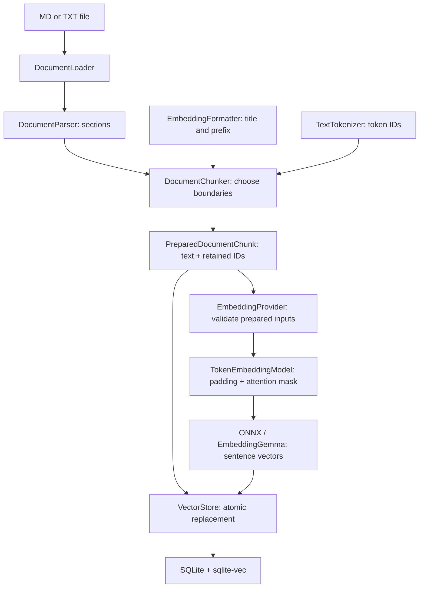
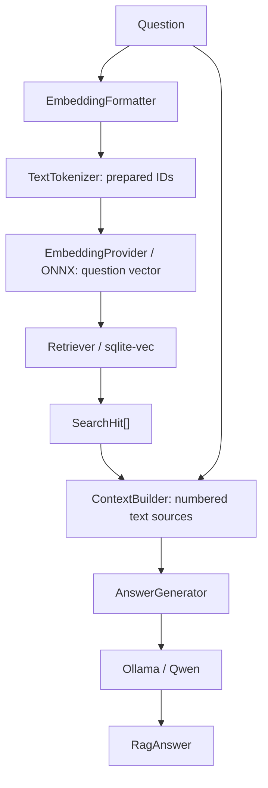

# Local RAG

English | [Russian](README.ru.md)

Local RAG ingests Markdown and TXT, retrieves relevant chunks, and answers questions from those sources. **Transformers.js + ONNX Runtime** runs EmbeddingGemma locally inside Node.js. The tokenizer prepares token IDs, and the model receives those same IDs. **SQLite + sqlite-vec** stores and compares vectors. A separate **Qwen model in Ollama** generates answers.

This is an educational TypeScript CLI project. Every stage has a technology-independent interface; one assembly function selects implementations. CLI messages and sample documents use English. Generated answers follow the language of the user's question. Empty retrieval returns a fixed English insufficient-information message without calling Ollama.

## Contents

- [Quick start](#quick-start)
- [Commands](#commands)
- [How RAG works](#how-rag-works)
- [Stage interfaces](#stage-interfaces)
- [Replacing a component](#replacing-a-component)
- [Configuration](#configuration)
- [Local data and migration](#local-data-and-migration)
- [Project structure](#project-structure)
- [Development and validation](#development-and-validation)
- [Dependencies and tools](#dependencies-and-tools)
- [Files stored in Git](#files-stored-in-git)
- [Limitations and troubleshooting](#limitations-and-troubleshooting)

## Quick start

Install **Node.js 24+**. Ollama is needed only for answer generation, not for setup, indexing, or vector search.

```bash
yarn install --immutable
cp .env.example .env
yarn setup
yarn check --embedding-only
yarn ingest examples/company.md
yarn ingest examples/it.txt
yarn search "How far in advance must employees on probation request leave?"
```

If `.env` already exists, edit it instead of overwriting it. An index produced by the old Ollama embedding backend must be rebuilt; see [migration](#local-data-and-migration).

To generate answers, install [Ollama](https://ollama.com/download), open its application or run `ollama serve`, then:

```bash
ollama pull qwen3.5:4b
yarn check
yarn ask "How far in advance must employees on probation request leave?"
yarn ask "За сколько календарных дней сотрудник на испытательном сроке должен запросить отпуск?"
```

The sample policies are fictional. The expected answer is **21 calendar days**, in the language of the question. Russian questions can use the same English documents; no separate index or translation is needed.

`yarn setup` downloads five files from a pinned Hugging Face revision: configuration, two tokenizer files, a q8 ONNX graph, and its external weights. Together they occupy **330,940,405 bytes**, about **316 MiB**. Each file is verified by size and SHA-256. Verified files are reused; failed downloads are not published.

Once prepared, `ingest` and `search` need neither internet nor Ollama. `ask` also computes embeddings locally, then calls the configured Ollama service for generation. Working commands never download missing model files.

Yarn **4.18.1** is pinned in `.yarn/releases`. You can use Corepack, or invoke the bundled executable:

```bash
node .yarn/releases/yarn-4.18.1.cjs install --immutable
node .yarn/releases/yarn-4.18.1.cjs setup
```

## Commands

| Command                           | Purpose                                                                                |
| --------------------------------- | -------------------------------------------------------------------------------------- |
| `yarn setup`                      | Prepare and verify the pinned tokenizer and q8 ONNX EmbeddingGemma; may download files |
| `yarn check`                      | Check SQLite, run a real local embedding, and check the Ollama answer model            |
| `yarn check --embedding-only`     | Check SQLite and ONNX embeddings without Ollama                                        |
| `yarn check --storage-only`       | Check SQLite and sqlite-vec without model files or Ollama                              |
| `yarn ingest "path/document.md"`  | Ingest or completely replace one document                                              |
| `yarn ingest "path/document.txt"` | Ingest plain text                                                                      |
| `yarn search "question"`          | Show nearest chunks and similarity scores                                              |
| `yarn ask "question"`             | Retrieve chunks and generate an answer with references                                 |
| `yarn cli --help`                 | Show command help                                                                      |

Check modes are mutually exclusive. Checks use an in-memory database and do not change the working index. Model availability and embedding inference are checked; LLM answer quality is assessed separately.

## How RAG works

### Preparation

`HuggingFaceModelRepository` implements `ModelArtifactRepository`. Its `prepare()` is the only model-provisioning operation that can access the internet. It streams downloads, verifies pinned size and SHA-256, and atomically renames completed files. Repeating setup repairs missing or damaged files.

`load()` verifies the local bundle without fetching anything. `AutoTokenizer` and `AutoModel` load its directory with `local_files_only: true`. SDK initialization is lazy, so help and fast tests do not initialize ONNX.

The profile selects [onnx-community/embeddinggemma-300m-ONNX](https://huggingface.co/onnx-community/embeddinggemma-300m-ONNX), revision `5090578d9565bb06545b4552f76e6bc2c93e4a66`, dtype `q8`. This export includes a ready `sentence_embedding` output.

### Indexing



#### 1. Loading and parsing

`FileDocumentLoader` resolves a physical path, checks extension and the 5 MiB size limit, reads UTF-8, and normalizes line endings. Supported extensions are `.md`, `.markdown`, and `.txt`. `LoadedDocument` contains the path, name, format, text, content hash, and an ID derived from the physical path.

`TextDocumentParser` uses a Markdown AST from remark. It preserves heading hierarchy and introductions, ignores headings inside code blocks, and retains reference definitions. TXT is one plain-text section. The output is `DocumentSection[]`.

#### 2. Formatting model inputs

`EmbeddingGemmaFormatter` prepares model-specific inputs:

```text
Document: title: company.md — Company policy → Leave | text: Chunk text...
Question: task: search result | query: Who approves leave?
```

Title, prefix, and special tokens count toward the token budget. Original chunk text remains separate for display and LLM context. The formatter signature is part of the index identity.

#### 3. Tokenization and chunking

`TransformersTextTokenizer` implements `TextTokenizer` using `AutoTokenizer`. `encode(text)` returns immutable numerical IDs and a signature identifying the verified model bundle. Special tokens are included by default; overlap measurement can exclude them.

`TokenDocumentChunker` measures complete formatted candidates, preserves sections and Unicode graphemes, prefers paragraph/line/whitespace boundaries, and bounds both tokens and characters. It does not add individual word counts, which would be inaccurate for subword tokenization.

Several candidate boundaries may require tokenization. **The selected candidate IDs are retained in `PreparedDocumentChunk.tokens` and passed unchanged to the embedding provider.** `tokenCount` equals their length. Inference does not decode them back to text or tokenize them again.

The target is 256 tokens with up to 32-token overlap by default. Overlap is also capped at half the previous chunk so splitting advances. EmbeddingGemma accepts at most 2048 tokens; the profile reserves 8 additional tokens. Oversized questions and chunks fail before inference, without silent truncation.

#### 4. Embedding inference

`TransformersEmbeddingProvider` validates tokenizer identity, IDs, input limits, vector count, dimensions, finite values, and nonzero vectors. It depends on `TokenEmbeddingModel`, not SDK tensor types.

`loadTransformersModel` provides that interface. It builds `input_ids` and `attention_mask` tensors from prepared IDs, right-pads batches, and calls `AutoModel.forward()`. **The runner accepts no text and has no tokenizer.** It reads `sentence_embedding`, rather than arbitrary token hidden states.

One fragment produces one vector. The default dimension is 768. Matryoshka dimensions 128, 256, and 512 are supported by truncating the full vector and normalizing it again. Input token counts exclude batch padding.

The pinned implementation uses **Transformers.js 3.8.1, ONNX Runtime Node 1.21, and CPU inference**, with four intra-operation threads by default. This combination includes a native module for macOS x64; ONNX Runtime 1.30 in newer Transformers.js releases does not ship that module. GPU execution is not configured or verified. This model profile uses q8, not fp16.

The session remains loaded within a command and is disposed on completion. A new CLI process loads it again; it is not a persistent embedding server.

#### 5. Storage

`SqliteVectorStore` implements `VectorStore`:

| Table           | Data                                                                |
| --------------- | ------------------------------------------------------------------- |
| `documents`     | Document ID, path, name, generation                                 |
| `chunks`        | Original text, formatted input, section, token count, line metadata |
| `chunk_vectors` | float32 vectors for cosine-distance search                          |
| `rag_meta`      | Embedding signature and dimensions                                  |

IDs are transient and are not saved in SQLite. `RagService` computes all vectors before storage. Replacement deletes old chunks and vectors and inserts new records in one transaction. Inference or SQL failure preserves the previously indexed document.

The index identity includes the verified bundle, inference implementation and Transformers.js version, tokenizer identity, dimensions, formatting, and input limit. Incompatible indexes are rejected. Search opens the index read-only. Unrelated SQLite databases are not initialized or modified.

### Retrieval and answers



`VectorRetriever` tokenizes the formatted question once and embeds those IDs with the document model. sqlite-vec compares its vector with stored vectors. `score = 1 - cosine_distance`: higher is more similar, not more certain. `TOP_K` limits results; optional `SCORE_THRESHOLD` filters them. Without a threshold, nearest chunks can be returned even when they lack an answer.

`SourcesContextBuilder` numbers whole chunks as `[1]`, `[2]` and builds an instruction and a question with JSON sources. Source content is data. Its character budget includes the instruction, question, and sources. Oversized chunks are skipped; an error is reported if none fit, or if the question and instruction alone exceed the budget. Empty retrieval bypasses context building and answer generation. This is not an exact Qwen token budget.

`OllamaAnswerGenerator` calls `client.chat()` with Qwen `qwen3.5:4b`. It rejects empty answers, unknown references, and length-truncated responses. These checks do not establish factual correctness. Qwen has its own tokenizer and is separate from EmbeddingGemma.

The system instruction asks Qwen to answer in the question's language even when sources use another language. For mixed-language questions, it asks for the main language of the question. If retrieved sources lack sufficient evidence, the model returns only a brief insufficient-information message in the same language, without citations. For example: “The documents do not contain enough information.” or “В документах недостаточно информации.” The exact wording can vary. Language selection belongs to the answer-generation stage; there is no separate language detector or translation dependency.

If no chunks are found, `RagService` immediately returns **“The documents do not contain enough information.”** in English for every question language, with empty sources and hits. It makes no Ollama request. This covers both an empty index and results filtered out by `SCORE_THRESHOLD`. Question embedding and vector search still run locally; Ollama is required only when chunks are retrieved and an answer must be generated.

## Stage interfaces

Definitions are in `src/core/contracts.ts`.

| Interface                 | Input → output                                    | Implementation                  |
| ------------------------- | ------------------------------------------------- | ------------------------------- |
| `ModelArtifactRepository` | Preparation/local verification → `ModelArtifacts` | `HuggingFaceModelRepository`    |
| `DocumentLoader`          | Path → document                                   | `FileDocumentLoader`            |
| `DocumentParser`          | Document → sections                               | `TextDocumentParser`            |
| `EmbeddingFormatter`      | Document/question → formatted text                | `EmbeddingGemmaFormatter`       |
| `TextTokenizer`           | Text → IDs and tokenizer identity                 | `TransformersTextTokenizer`     |
| `DocumentChunker`         | Document and sections → `PreparedDocumentChunk[]` | `TokenDocumentChunker`          |
| `TokenEmbeddingModel`     | ID sequences → full sentence vectors              | `loadTransformersModel` adapter |
| `EmbeddingProvider`       | Prepared inputs → validated vectors               | `TransformersEmbeddingProvider` |
| `VectorStore`             | Indexed chunks → storage; vector → hits           | `SqliteVectorStore`             |
| `Retriever`               | Question → hits                                   | `VectorRetriever`               |
| `ContextBuilder`          | Question and hits → context                       | `SourcesContextBuilder`         |
| `AnswerGenerator`         | Context → answer                                  | `OllamaAnswerGenerator`         |

Prepared input has no SDK tensors:

```ts
interface TokenizedInput {
  readonly tokenIds: readonly number[];
  readonly tokenizerSignature: string;
}
```

`RagService` orchestrates interfaces without importing Transformers.js, Ollama, or SQLite. `application.ts` selects adapters and cleans up partial assembly failures. `RagService.close()` awaits storage and model disposal, including model cleanup if storage cleanup fails.

## Replacing a component

1. Implement its interface and select it in `application.ts`.
2. Keep general settings in `config.ts`, adapter settings in `runtime-config.ts`, and model assumptions in its profile.
3. Test input/output identity, limits, error propagation, and resource cleanup.
4. Rebuild the index when weights, tokenizer, backend signature, dimensions, or formatting change.

A new chunker returns original text and prepared IDs. A new inference runner consumes IDs and returns full sentence vectors. A parser still returns sections; a store must support atomic document replacement. A different vocabulary requires changing tokenizer and model together. Answer generation can be replaced independently.

## Configuration

CLI commands load `.env` before startup. `.env.example` contains the main defaults.

| Variable                    | Default                  | Purpose                                    |
| --------------------------- | ------------------------ | ------------------------------------------ |
| `SQLITE_PATH`               | `data/rag.sqlite`        | Working index                              |
| `EMBEDDING_CACHE`           | `.cache/models`          | Verified model/tokenizer bundles           |
| `EMBEDDING_THREADS`         | `4`                      | CPU threads, 1–64                          |
| `EMBEDDING_DIMENSIONS`      | `768`                    | 128, 256, 512, or 768                      |
| `EMBEDDING_MAX_TOKENS`      | `2048`                   | Model input cap                            |
| `EMBEDDING_BATCH_SIZE`      | `16`                     | Fragments per batch                        |
| `MODEL_DOWNLOAD_TIMEOUT_MS` | `600000`                 | Timeout per model file                     |
| `CHUNK_TOKENS`              | `256`                    | Target including formatting/special tokens |
| `CHUNK_OVERLAP`             | `32`                     | Maximum overlap                            |
| `CHUNK_MAX_CHARACTERS`      | `4096`                   | Additional size cap                        |
| `TOP_K`                     | `5`                      | Maximum retrieved chunks                   |
| `SCORE_THRESHOLD`           | unset                    | Optional similarity threshold              |
| `CONTEXT_MAX_CHARACTERS`    | `12000`                  | Instruction, question, sources             |
| `OLLAMA_URL`                | `http://127.0.0.1:11434` | Answer-generation service                  |
| `OLLAMA_MODEL`              | `qwen3.5:4b`             | Answer model                               |
| `OLLAMA_TIMEOUT_MS`         | `300000`                 | Ollama request timeout                     |
| `OLLAMA_KEEP_ALIVE`         | `5m`                     | Answer-model residence time                |
| `LLM_CONTEXT_TOKENS`        | `8192`                   | Qwen context window                        |
| `LLM_MAX_OUTPUT_TOKENS`     | `512`                    | Answer limit                               |

The repository, revision, dtype, vocabulary, padding ID, and hashes are fixed in `model-profiles/embeddinggemma.ts`. A different model needs a coherent profile. The system prompt, including the question-language rule, and document size cap are in `config.ts`. Changing the answer-language rule does not require rebuilding the index.

## Local data and migration

The cache is still required:

```text
.cache/models/
  onnx-community--embeddinggemma-300m-ONNX/
    5090578d9565bb06545b4552f76e6bc2c93e4a66/
      config.json
      tokenizer.json
      tokenizer_config.json
      onnx/
        model_quantized.onnx
        model_quantized.onnx_data
```

EmbeddingGemma files stay in this cache; Qwen stays in Ollama model storage. `setup` does not pull Qwen or an Ollama copy of EmbeddingGemma.

For an existing installation:

1. Remove `OLLAMA_EMBEDDING_MODEL` and `TOKENIZER_CACHE` from `.env`; add `EMBEDDING_CACHE` and optionally `EMBEDDING_THREADS`.
2. Run `yarn install --immutable`, `yarn setup`, and `yarn check --embedding-only`.
3. Build a new index from the original documents:

```bash
SQLITE_PATH=./data/rag-onnx.sqlite yarn ingest examples/company.md
SQLITE_PATH=./data/rag-onnx.sqlite yarn ingest examples/it.txt
SQLITE_PATH=./data/rag-onnx.sqlite yarn search "Who approves leave?"
```

4. Set `SQLITE_PATH=./data/rag-onnx.sqlite` in `.env`.
5. After the new bundle and index work, remove the obsolete project `.cache/tokenizers` directory.

A signature mismatch does not overwrite the old index. Equal dimensions alone do not make the two backends interchangeable.

| Change                                                       | Action                         |
| ------------------------------------------------------------ | ------------------------------ |
| Document text, parser, chunk size/overlap                    | Reingest affected documents    |
| Bundle, tokenizer, backend signature, dimensions, formatting | New index and full reingestion |
| Answer model/settings, retrieval limit, similarity threshold | No embedding rebuild           |

SQLite may create `-wal` and `-shm` files. Back up a closed database or use its consistent backup API. Physical-path IDs mean renaming or moving a source creates a new entry; automatic removal of the previous entry is not implemented.

## Project structure

```text
src/
  cli.ts                 commands and help
  config.ts              general RAG settings
  runtime-config.ts      adapter settings
  application.ts         assembly and lifecycle
  core/                  interfaces and orchestration
  model-profiles/        pinned bundle and formatting
  models/                preparation and integrity checks
  documents/             file loading and section parsing
  tokenization/          text → immutable IDs
  chunking/              boundaries and retained tokens
  embeddings/            formatting, validation, ONNX inference
  storage/               SQLite and vector search
  retrieval/             question → IDs → vector → hits
  generation/            context and answer generation
  ollama/                answer-model client
examples/                fictional documents
tests/                   fast tests without model weights or Ollama
scripts/                 checks using real models
.yarn/releases/          pinned Yarn
```

## Development and validation

```bash
yarn validate
yarn test:integration
yarn test:llm
```

`validate` runs TypeScript, ESLint, Prettier, fast tests, and a build. Fast tests use fake stage implementations and small temporary assets; they need neither model weights nor internet nor Ollama.

`test:integration` requires `setup` but no Ollama. It checks the fixed English empty-retrieval response for English and Russian questions with network requests blocked, real vectors, single versus padded-batch inference, limits, English/Unicode inputs, retrieval, TXT, duplicate prevention, and document replacement. `test:llm` also requires running Ollama and Qwen; it checks English and Russian answers against English documents, source citations, the fixed English empty-retrieval response, and insufficient-information messages in the question's language when retrieved sources lack an answer.

Individual commands: `typecheck`, `lint`, `lint:fix`, `format`, `format:check`, `test`, `build`. After building:

```bash
yarn start search "Who approves leave?"
```

## Dependencies and tools

| Dependency                                              | Purpose                                        |
| ------------------------------------------------------- | ---------------------------------------------- |
| `@huggingface/transformers` 3.8.1                       | AutoTokenizer and AutoModel                    |
| `ollama`                                                | Answer generation through `chat()`             |
| `unified`, `remark-parse`                               | Markdown AST                                   |
| `sqlite-vec`                                            | Vector storage/search; SQLite is `node:sqlite` |
| `typescript`, `@types/node`, `tsx`                      | Types, build, TypeScript execution             |
| `eslint`, `@eslint/js`, `typescript-eslint`, `prettier` | Lint and formatting                            |

ONNX Runtime is a transitive dependency. The direct `@huggingface/tokenizers` dependency and its declaration patch were removed. Direct versions are pinned; transitive versions are locked in `yarn.lock`.

ONNX Runtime and sqlite-vec contain native components. Install them for the Node.js architecture used to run the project. The pinned inference combination supports the current macOS x64 runtime; dependency changes require real-model validation.

Yarn 4.18.1 is bundled; `.yarnrc` redirects Yarn 1 to it. The 24-hour `npmMinimalAgeGate` remains configured. TypeScript 6.0.3 and typescript-eslint 8.71.1 are pinned; check their compatibility before upgrading.

## Files stored in Git

Git contains source, tests, samples, both README versions, configuration, `.env.example`, manifests, and pinned Yarn. `.gitignore` excludes installed dependencies/caches, model bundles, indexes/journals, local `.env`, build output, IDE settings, logs, and temporary files. On another computer run `yarn install --immutable` and `yarn setup` rather than committing weights.

## Limitations and troubleshooting

- Only MD/Markdown/TXT up to 5 MiB are supported. PDF/OCR and external source connectors are not implemented.
- Large tables/code may split internally; line ranges refer to sections.
- Similarity is not confidence. LLM context uses a character budget.
- CPU/q8 is configured. Each CLI invocation loads the model; GPU and a persistent server are future adapters.
- Missing/damaged model or tokenizer files: `yarn setup`. Working commands never download replacements.
- Incompatible index: new `SQLITE_PATH` and reingestion.
- Ollama errors affect `ask`, full `check`, and `test:llm`: check the service and `ollama pull qwen3.5:4b`.
- Missing native ONNX module: verify Node.js architecture and the pinned installation.
