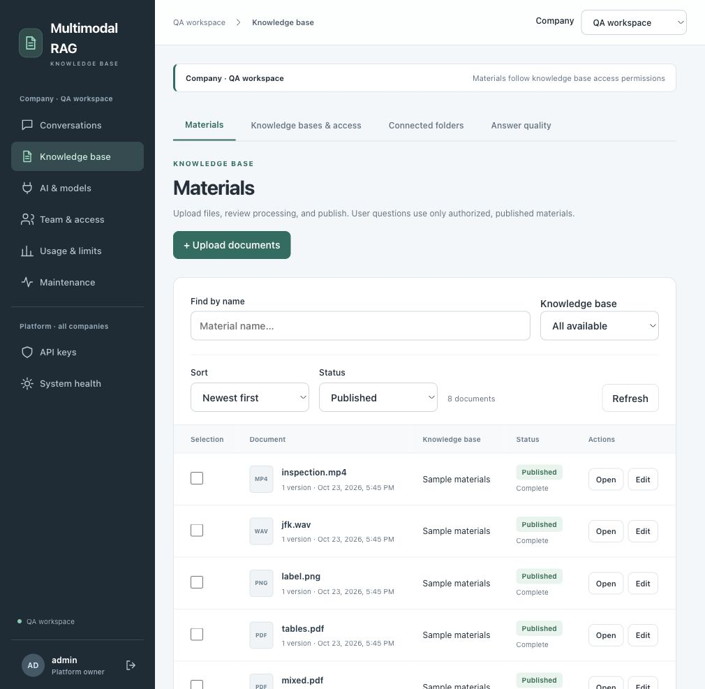
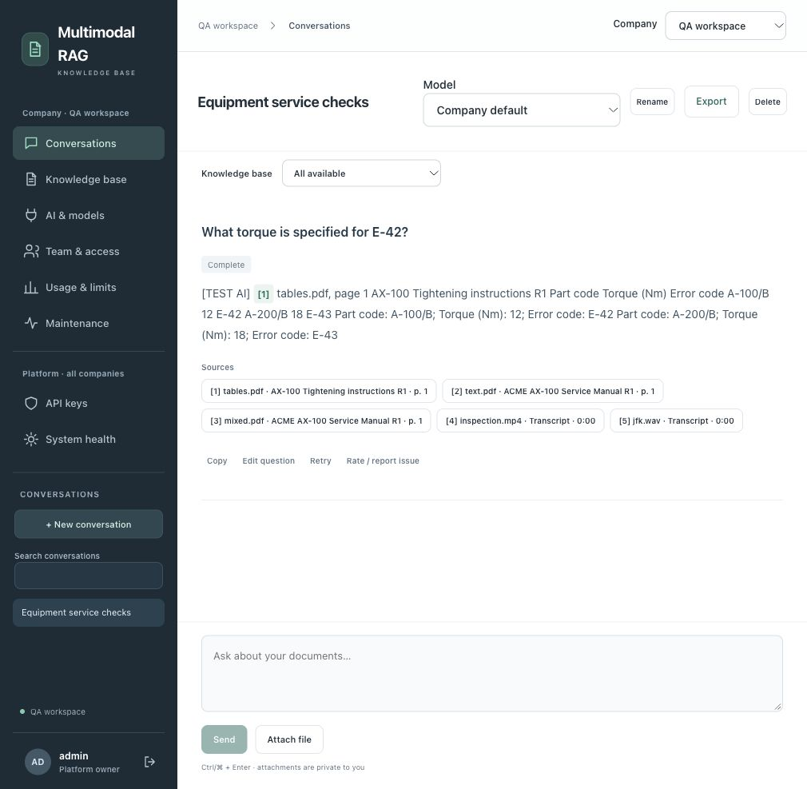
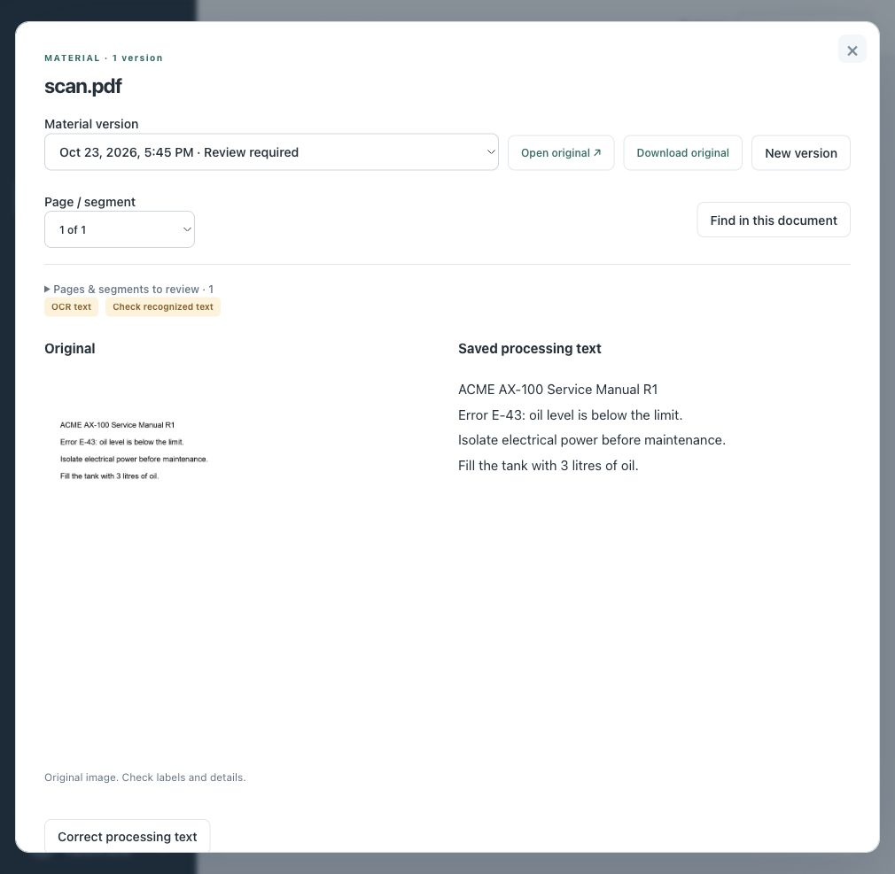
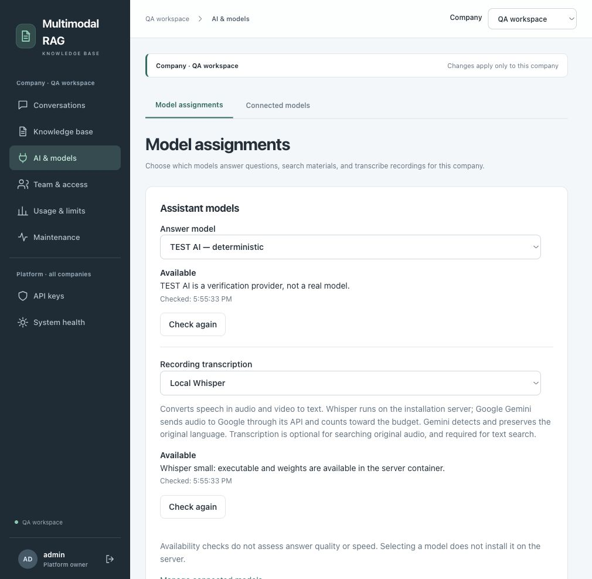

# Multimodal RAG Knowledge Base

**A self-hosted knowledge workspace: upload, review, publish, and ask questions with source citations.**

Text, PDFs, images, audio, and video in one library. Separate companies and roles, keep original files, and choose local models or remote APIs.

[Русский](README.ru.md) · [Documentation](docs/README.md) · [Architecture](docs/ARCHITECTURE.md) · [Security](SECURITY.md)



## What it does

- **Search across media:** text embeddings with descriptions/transcripts, or native multimodal embeddings supported by your provider.
- **Review before publishing:** correct OCR, descriptions, and transcripts; publish a replacement while the current version stays searchable.
- **Check the evidence:** cited text windows, originals, media segments, and literal find inside long documents.
- **Separate access:** company memberships, user/editor/admin roles, knowledge-base grants, and independent platform ownership. Personal chats stay private.
- **Choose your AI:** Ollama, Whisper, Google, Anthropic, and OpenAI-compatible APIs, with separate task assignments, connections, and encrypted keys.
- **Operate the workflow:** durable jobs, folder sync, budget estimates, quality checks, audit, and verified backups.

## Try it locally

Requires **Node.js 24.19+** and **Docker with Compose v2**. Yarn is pinned; if `yarn` is unavailable, use `node .yarn/releases/yarn-4.18.1.cjs` in its place.

```sh
git clone https://github.com/ichernetskii/multimodal-rag-knowledge-base.git
cd multimodal-rag-knowledge-base
yarn install --immutable
yarn configure
yarn infra:up
yarn cli init
yarn seed
yarn dev
```

Open **http://localhost:5173**. Development login: **`admin` / `local-development-only`**. The default uses labelled **TEST AI** without provider keys; it demonstrates the workflow and does not generate real LLM answers. `yarn configure` creates private local credentials in ignored `.env`.

On later starts, run only `yarn infra:up` and `yarn dev`. Wait for API/workers; readiness is at `http://127.0.0.1:3210/health/ready`.

For native PDF/OCR/audio/video, run `yarn prepare:pdf` and `yarn prepare:media` once. Prefer containers for a bundled processing runtime: [local models in Docker](docs/DEVELOPMENT.md#local-models-in-docker). See [startup troubleshooting](docs/DEVELOPMENT.md#startup-troubleshooting) if a service fails.

## Your first knowledge base

1. Sign in, select a company, and create a base under **Knowledge base → Knowledge bases & access**. Grant team access.
2. Upload materials, inspect the processing text against the original, correct errors, then publish and wait for indexing.
3. Ask a question in **Conversations** and open its citations.

To import all nine [sample materials](examples/knowledge-base/README.md), keep API/workers running:

```sh
yarn cli login admin
yarn cli tenants list
yarn cli tenant-use COMPANY_UUID
yarn demo:import
```

The import creates a separate base for review. Real providers can incur processing/indexing charges. For real answers, the platform owner connects models and keys; a company administrator assigns them to tasks. [Models and media](docs/MEDIA.md) explains descriptions, speech recognition, and model switching.

## Inside the application



<details>
<summary>Material review and model administration</summary>





</details>

All four screenshots show the running application with disposable sample data. The conversation uses deterministic TEST AI, so it illustrates the UI rather than model quality.

## Develop or deploy

React/Vite/TypeScript → Node.js API and workers → PostgreSQL (pgvector, RLS, pg-boss), private S3, and disposable Redis. The CLI uses the same public API.

```sh
yarn validate            # contracts, docs, types, lint, tests, builds
yarn test:integration    # isolated DB/S3; requires development infrastructure
yarn test:docker         # disposable deployment and real media processing
```

[Development](docs/DEVELOPMENT.md) · [Configuration](docs/CONFIGURATION.md) · [Production & recovery](docs/OPERATIONS.md) · [Contributing](CONTRIBUTING.md) · [Verification](docs/VERIFICATION.md)

**Status:** unreleased; one current schema/API, no automatic migration from incompatible development data. Production requires private configuration, HTTPS, an operator account, and real providers; development seed and TEST AI are prohibited. Costs are estimates. SSO/SAML, payments, microphone dictation, and enterprise DLP/antivirus are outside the [current scope](docs/REQUIREMENTS.md).
