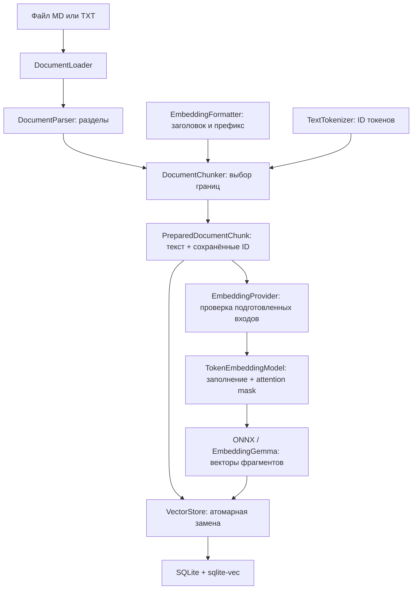
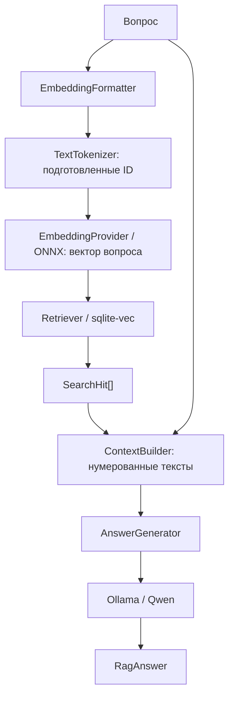

# Local RAG

[English](README.md) | Русский

Приложение загружает Markdown и TXT, находит подходящие фрагменты и отвечает на вопросы по ним. **Transformers.js + ONNX Runtime** запускает EmbeddingGemma локально внутри Node.js. Токенизатор готовит ID токенов, и модель получает те же ID. **SQLite + sqlite-vec** хранит и сравнивает векторы. Отдельная **модель Qwen в Ollama** пишет ответы.

Это учебный CLI-проект на TypeScript. Каждый этап имеет интерфейс, независимый от конкретной технологии; реализации выбираются в одной функции сборки. Сообщения CLI и примеры документов — на английском. Сгенерированные ответы следуют языку вопроса пользователя. При пустом поиске возвращается фиксированное английское сообщение о нехватке информации без вызова Ollama.

## Содержание

- [Быстрый запуск](#быстрый-запуск)
- [Команды](#команды)
- [Как устроен RAG](#как-устроен-rag)
- [Интерфейсы этапов](#интерфейсы-этапов)
- [Как заменить компонент](#как-заменить-компонент)
- [Конфигурация](#конфигурация)
- [Локальные данные и переход](#локальные-данные-и-переход)
- [Структура проекта](#структура-проекта)
- [Разработка и проверки](#разработка-и-проверки)
- [Зависимости и инструменты](#зависимости-и-инструменты)
- [Что хранится в Git](#что-хранится-в-git)
- [Ограничения и ошибки](#ограничения-и-ошибки)

## Быстрый запуск

Нужна **Node.js 24+**. Ollama требуется только для генерации ответа: подготовка модели, индексация и векторный поиск работают без неё.

```bash
yarn install --immutable
cp .env.example .env
yarn setup
yarn check --embedding-only
yarn ingest examples/company.md
yarn ingest examples/it.txt
yarn search "How far in advance must employees on probation request leave?"
```

Если `.env` уже существует, отредактируй его вместо копирования поверх. Индекс старого embedding-провайдера Ollama нужно перестроить; см. [переход](#локальные-данные-и-переход).

Для ответов установи [Ollama](https://ollama.com/download), открой приложение или запусти `ollama serve`, затем:

```bash
ollama pull qwen3.5:4b
yarn check
yarn ask "How far in advance must employees on probation request leave?"
yarn ask "За сколько календарных дней сотрудник на испытательном сроке должен запросить отпуск?"
```

Учебные правила вымышленные. Ожидаемый ответ — **21 календарный день**, на языке вопроса. Русские вопросы используют те же английские документы; отдельный индекс или перевод документов не нужен.

`yarn setup` скачивает пять файлов из закреплённой ревизии Hugging Face: конфигурацию, два файла токенизатора, ONNX-граф q8 и его внешние веса. Общий размер — **330 940 405 байт**, около **316 МиБ**. Для каждого файла проверяются размер и SHA-256. Проверенные файлы используются повторно; неудачная загрузка не публикуется.

После подготовки `ingest` и `search` не требуют интернета или Ollama. `ask` тоже вычисляет эмбеддинги локально, затем обращается к настроенному сервису Ollama за ответом. Рабочие команды не скачивают отсутствующие файлы модели.

Yarn **4.18.1** закреплён в `.yarn/releases`. Можно использовать Corepack или комплектный исполняемый файл:

```bash
node .yarn/releases/yarn-4.18.1.cjs install --immutable
node .yarn/releases/yarn-4.18.1.cjs setup
```

## Команды

| Команда                           | Назначение                                                                             |
| --------------------------------- | -------------------------------------------------------------------------------------- |
| `yarn setup`                      | Подготавливает и проверяет токенизатор и ONNX EmbeddingGemma q8; может скачивать файлы |
| `yarn check`                      | Проверяет SQLite, настоящий локальный embedding-запрос и модель ответов в Ollama       |
| `yarn check --embedding-only`     | Проверяет SQLite и ONNX-эмбеддинги без Ollama                                          |
| `yarn check --storage-only`       | Проверяет SQLite и sqlite-vec без файлов модели и Ollama                               |
| `yarn ingest "путь/документ.md"`  | Загружает или полностью заменяет один документ                                         |
| `yarn ingest "путь/документ.txt"` | Загружает обычный текст                                                                |
| `yarn search "вопрос"`            | Показывает ближайшие фрагменты и оценки близости                                       |
| `yarn ask "вопрос"`               | Находит фрагменты и получает ответ со ссылками                                         |
| `yarn cli --help`                 | Показывает подсказку                                                                   |

Режимы проверки взаимоисключающие. Проверки используют базу в памяти и не меняют рабочий индекс. Проверяются доступность модели и embedding-инференс; качество ответов LLM оценивается отдельно.

## Как устроен RAG

### Подготовка

`HuggingFaceModelRepository` реализует `ModelArtifactRepository`. Его `prepare()` — единственная операция подготовки модели, которая может обращаться к интернету. Она скачивает данные потоком, проверяет закреплённые размер и SHA-256 и атомарно переименовывает готовые файлы. Повторный setup восстанавливает отсутствующие или повреждённые файлы.

`load()` проверяет локальный комплект без скачивания. `AutoTokenizer` и `AutoModel` загружают его каталог с `local_files_only: true`. SDK инициализируется лениво: help и быстрые тесты не запускают ONNX.

Профиль выбирает [onnx-community/embeddinggemma-300m-ONNX](https://huggingface.co/onnx-community/embeddinggemma-300m-ONNX), ревизию `5090578d9565bb06545b4552f76e6bc2c93e4a66`, dtype `q8`. Экспорт содержит готовый выход `sentence_embedding`.

### Индексация



#### 1. Загрузка и разбор

`FileDocumentLoader` определяет физический путь, проверяет расширение и лимит 5 МиБ, читает UTF-8 и нормализует переносы строк. Поддерживаются `.md`, `.markdown` и `.txt`. `LoadedDocument` содержит путь, имя, формат, текст, хеш содержимого и ID, вычисленный из физического пути.

`TextDocumentParser` использует Markdown AST из remark. Он сохраняет иерархию заголовков и вступление, игнорирует заголовки внутри кода и сохраняет определения ссылок. TXT становится одним текстовым разделом. Результат — `DocumentSection[]`.

#### 2. Форматирование входов

`EmbeddingGemmaFormatter` подготавливает входы выбранной модели:

```text
Документ: title: company.md — Company policy → Leave | text: Chunk text...
Вопрос:   task: search result | query: Who approves leave?
```

Заголовок, префикс и специальные токены входят в токеновый бюджет. Исходный текст фрагмента сохраняется отдельно для показа и контекста LLM. Подпись форматирования входит в идентичность индекса.

#### 3. Токенизация и чанкинг

`TransformersTextTokenizer` реализует `TextTokenizer` через `AutoTokenizer`. Метод `encode(text)` возвращает неизменяемые числовые ID и подпись проверенного комплекта модели. По умолчанию включаются специальные токены; при измерении перекрытия их можно исключить.

`TokenDocumentChunker` измеряет полные подготовленные варианты текста, сохраняет разделы и Unicode-графемы, предпочитает границы абзацев, строк или пробелов и ограничивает размер токенами и символами. Количества токенов отдельных слов не складываются: для токенизации по частям слов такая сумма неточна.

При подборе границ может потребоваться токенизация нескольких вариантов. **ID выбранного варианта сохраняются в `PreparedDocumentChunk.tokens` и без изменения передаются embedding-провайдеру.** `tokenCount` равен их количеству. При инференсе они не преобразуются обратно в текст и не токенизируются повторно.

По умолчанию цель — 256 токенов с перекрытием до 32. Перекрытие также ограничено половиной предыдущего фрагмента, чтобы обработка продвигалась. EmbeddingGemma принимает до 2048 токенов; профиль оставляет запас 8 токенов. Слишком длинные вопросы и фрагменты отклоняются до инференса без молчаливого обрезания.

#### 4. Создание эмбеддингов

`TransformersEmbeddingProvider` проверяет идентичность токенизатора, ID, лимиты, число и размерность векторов, конечность значений и ненулевой результат. Он зависит от `TokenEmbeddingModel`, а не от типов тензоров SDK.

`loadTransformersModel` предоставляет этот интерфейс. Он создаёт тензоры `input_ids` и `attention_mask` из подготовленных ID, дополняет пакеты справа и вызывает `AutoModel.forward()`. **Движок принимает только ID; токенизатора в нём нет.** Используется выход `sentence_embedding`, а не произвольные скрытые состояния отдельных токенов.

Один фрагмент даёт один вектор. По умолчанию размерность — 768. Размерности Matryoshka 128, 256 и 512 поддерживаются обрезанием полного вектора и повторной нормализацией. Заполняющие токены пакета не входят в счётчик реальных входных ID.

Закреплена связка **Transformers.js 3.8.1, ONNX Runtime Node 1.21 и вычисления на CPU**, по умолчанию с четырьмя потоками внутри операции. Она содержит нативный модуль для macOS x64; ONNX Runtime 1.30 из новых версий Transformers.js не поставляет такой модуль. Выполнение на GPU в этой реализации не настроено и не проверено. Профиль использует q8, а не fp16.

Сессия модели остаётся загруженной в пределах одной команды и освобождается после её завершения. Новый процесс CLI загружает её снова; постоянно работающего embedding-сервера здесь нет.

#### 5. Хранение

`SqliteVectorStore` реализует `VectorStore`:

| Таблица         | Данные                                                             |
| --------------- | ------------------------------------------------------------------ |
| `documents`     | ID документа, путь, имя, версия                                    |
| `chunks`        | Исходный текст, подготовленный вход, раздел, число токенов, строки |
| `chunk_vectors` | Векторы float32 для поиска по cosine distance                      |
| `rag_meta`      | Подпись embedding-конфигурации и размерность                       |

ID токенов временные и в SQLite не сохраняются. `RagService` вычисляет все векторы до записи. Замена удаляет старые фрагменты и векторы и вставляет новые в одной транзакции. Ошибка модели или SQL сохраняет предыдущую индексированную версию документа.

Идентичность индекса включает проверенный комплект модели, реализацию инференса и версию Transformers.js, токенизатор, размерность, форматирование и лимит входа. Несовместимый индекс отклоняется. Поиск открывает индекс read-only. Чужие SQLite-базы не инициализируются и не изменяются.

### Поиск и ответы



`VectorRetriever` один раз токенизирует подготовленный вопрос и передаёт ID той же модели, которой индексировались документы. sqlite-vec сравнивает результат с сохранёнными векторами. `score = 1 - cosine_distance`: больше означает ближе, а не достовернее. `TOP_K` ограничивает число результатов, `SCORE_THRESHOLD` при необходимости фильтрует их. Без порога могут возвращаться ближайшие тексты, в которых нет ответа.

`SourcesContextBuilder` присваивает целым фрагментам номера `[1]`, `[2]` и готовит инструкцию и вопрос с источниками в JSON. Содержимое источников трактуется как данные. Бюджет символов включает инструкцию, вопрос и источники. Слишком большие фрагменты пропускаются; если ни один не помещается, возникает ошибка. Вопрос и инструкция также не могут превышать бюджет. При пустом поиске этапы подготовки контекста и генерации ответа пропускаются. Это не точный токеновый бюджет Qwen.

`OllamaAnswerGenerator` вызывает `client.chat()` с Qwen `qwen3.5:4b`. Он отклоняет пустые ответы, неизвестные номера источников и ответы, оборванные лимитом длины. Эти проверки не гарантируют правильность фактов. У Qwen свой токенизатор; это отдельная от EmbeddingGemma модель.

Системная инструкция просит Qwen отвечать на языке вопроса, даже если источники написаны на другом языке. Для смешанных вопросов выбирается основной язык вопроса. Если в найденных источниках недостаточно сведений, модель возвращает только краткое сообщение о нехватке информации на том же языке, без ссылок. Например: «В документах недостаточно информации.» или «The documents do not contain enough information.» Точная формулировка может отличаться. Выбор языка остаётся частью этапа генерации ответа; отдельного детектора языка или зависимости для перевода нет.

Если фрагменты не найдены, `RagService` сразу возвращает **«The documents do not contain enough information.»** на английском при любом языке вопроса, с пустыми списками источников и результатов. Запрос к Ollama не выполняется. Это относится как к пустому индексу, так и к результатам, отфильтрованным через `SCORE_THRESHOLD`. Эмбеддинг вопроса и векторный поиск по-прежнему выполняются локально; Ollama нужна только при наличии найденных фрагментов для генерации ответа.

## Интерфейсы этапов

Определения находятся в `src/core/contracts.ts`.

| Интерфейс                 | Вход → выход                                      | Реализация                      |
| ------------------------- | ------------------------------------------------- | ------------------------------- |
| `ModelArtifactRepository` | Подготовка/локальная проверка → `ModelArtifacts`  | `HuggingFaceModelRepository`    |
| `DocumentLoader`          | Путь → документ                                   | `FileDocumentLoader`            |
| `DocumentParser`          | Документ → разделы                                | `TextDocumentParser`            |
| `EmbeddingFormatter`      | Документ/вопрос → подготовленный текст            | `EmbeddingGemmaFormatter`       |
| `TextTokenizer`           | Текст → ID и идентичность токенизатора            | `TransformersTextTokenizer`     |
| `DocumentChunker`         | Документ и разделы → `PreparedDocumentChunk[]`    | `TokenDocumentChunker`          |
| `TokenEmbeddingModel`     | Последовательности ID → полные векторы фрагментов | Адаптер `loadTransformersModel` |
| `EmbeddingProvider`       | Подготовленные входы → проверенные векторы        | `TransformersEmbeddingProvider` |
| `VectorStore`             | Фрагменты → хранение; вектор → результаты         | `SqliteVectorStore`             |
| `Retriever`               | Вопрос → результаты                               | `VectorRetriever`               |
| `ContextBuilder`          | Вопрос и результаты → контекст                    | `SourcesContextBuilder`         |
| `AnswerGenerator`         | Контекст → ответ                                  | `OllamaAnswerGenerator`         |

Подготовленный вход не содержит тензоров SDK:

```ts
interface TokenizedInput {
  readonly tokenIds: readonly number[];
  readonly tokenizerSignature: string;
}
```

`RagService` связывает интерфейсы без импортов Transformers.js, Ollama и SQLite. `application.ts` выбирает адаптеры и освобождает ресурсы при неудачной сборке. `RagService.close()` ожидает закрытие базы и модели, включая освобождение модели при ошибке закрытия базы.

## Как заменить компонент

1. Реализуй его интерфейс и выбери реализацию в `application.ts`.
2. Общие настройки держи в `config.ts`, параметры адаптеров — в `runtime-config.ts`, предположения о модели — в её профиле.
3. Проверь идентичность входов/выходов, лимиты, передачу ошибок и освобождение ресурсов.
4. При изменении весов, токенизатора, подписи движка, размерности или форматирования перестрой индекс.

Новый чанкер возвращает исходный текст и подготовленные ID. Новый движок принимает ID и возвращает полные векторы фрагментов. Парсер продолжает возвращать разделы; хранилище должно поддерживать атомарную замену документа. Другой словарь требует смены токенизатора и модели вместе. Генерацию ответа можно заменить независимо.

## Конфигурация

CLI загружает `.env` до запуска приложения. Основные значения приведены в `.env.example`.

| Переменная                  | По умолчанию             | Назначение                                     |
| --------------------------- | ------------------------ | ---------------------------------------------- |
| `SQLITE_PATH`               | `data/rag.sqlite`        | Рабочий индекс                                 |
| `EMBEDDING_CACHE`           | `.cache/models`          | Проверенные комплекты модели и токенизатора    |
| `EMBEDDING_THREADS`         | `4`                      | Потоки CPU, 1–64                               |
| `EMBEDDING_DIMENSIONS`      | `768`                    | 128, 256, 512 или 768                          |
| `EMBEDDING_MAX_TOKENS`      | `2048`                   | Лимит входа модели                             |
| `EMBEDDING_BATCH_SIZE`      | `16`                     | Фрагментов в пакете                            |
| `MODEL_DOWNLOAD_TIMEOUT_MS` | `600000`                 | Таймаут каждого файла                          |
| `CHUNK_TOKENS`              | `256`                    | Цель с форматированием и специальными токенами |
| `CHUNK_OVERLAP`             | `32`                     | Максимальное перекрытие                        |
| `CHUNK_MAX_CHARACTERS`      | `4096`                   | Дополнительный лимит размера                   |
| `TOP_K`                     | `5`                      | Максимум найденных фрагментов                  |
| `SCORE_THRESHOLD`           | не задан                 | Необязательный порог близости                  |
| `CONTEXT_MAX_CHARACTERS`    | `12000`                  | Инструкция, вопрос и источники                 |
| `OLLAMA_URL`                | `http://127.0.0.1:11434` | Сервис генерации ответов                       |
| `OLLAMA_MODEL`              | `qwen3.5:4b`             | Модель ответов                                 |
| `OLLAMA_TIMEOUT_MS`         | `300000`                 | Таймаут Ollama                                 |
| `OLLAMA_KEEP_ALIVE`         | `5m`                     | Время удержания модели ответов                 |
| `LLM_CONTEXT_TOKENS`        | `8192`                   | Контекст Qwen                                  |
| `LLM_MAX_OUTPUT_TOKENS`     | `512`                    | Лимит ответа                                   |

Репозиторий, ревизия, dtype, словарь, ID заполнения и хеши закреплены в `model-profiles/embeddinggemma.ts`. Для другой модели нужен согласованный профиль. Системная инструкция, включая правило языка ответа, и лимит документа находятся в `config.ts`. Изменение правила языка ответа не требует перестроения индекса.

## Локальные данные и переход

Кеш по-прежнему нужен:

```text
.cache/models/
  onnx-community--embeddinggemma-300m-ONNX/
    5090578d9565bb06545b4552f76e6bc2c93e4a66/
      config.json
      tokenizer.json
      tokenizer_config.json
      onnx/
        model_quantized.onnx
        model_quantized.onnx_data
```

Файлы EmbeddingGemma находятся в этом кеше; Qwen — в хранилище моделей Ollama. `setup` не скачивает Qwen или копию EmbeddingGemma для Ollama.

Для существующей установки:

1. Удали `OLLAMA_EMBEDDING_MODEL` и `TOKENIZER_CACHE` из `.env`; добавь `EMBEDDING_CACHE` и при необходимости `EMBEDDING_THREADS`.
2. Выполни `yarn install --immutable`, `yarn setup` и `yarn check --embedding-only`.
3. Создай новый индекс из исходных документов:

```bash
SQLITE_PATH=./data/rag-onnx.sqlite yarn ingest examples/company.md
SQLITE_PATH=./data/rag-onnx.sqlite yarn ingest examples/it.txt
SQLITE_PATH=./data/rag-onnx.sqlite yarn search "Who approves leave?"
```

4. Укажи `SQLITE_PATH=./data/rag-onnx.sqlite` в `.env`.
5. После проверки нового комплекта и индекса удали устаревшую проектную папку `.cache/tokenizers`.

Несовпадение подписи не перезаписывает старый индекс. Одинаковая размерность сама по себе не делает два embedding-движка взаимозаменяемыми.

| Изменение                                                                 | Действие                           |
| ------------------------------------------------------------------------- | ---------------------------------- |
| Текст, парсер, размер/перекрытие фрагментов                               | Повторить ingest нужных документов |
| Комплект модели, токенизатор, подпись движка, размерность, форматирование | Новый индекс и полная индексация   |
| Модель ответов, её параметры, число результатов, порог близости           | Перестроение не требуется          |

SQLite может создавать `-wal` и `-shm`. Копируй закрытую базу либо используй согласованное резервное копирование SQLite. ID зависит от физического пути: переименование или перемещение исходника создаёт новую запись; автоматического удаления прежней записи здесь нет.

## Структура проекта

```text
src/
  cli.ts                 команды и help
  config.ts              общие настройки RAG
  runtime-config.ts      параметры адаптеров
  application.ts         сборка и жизненный цикл
  core/                  интерфейсы и оркестрация
  model-profiles/        закреплённый комплект и форматирование
  models/                подготовка и проверка целостности
  documents/             загрузка файлов и разбор разделов
  tokenization/          текст → неизменяемые ID
  chunking/              границы и сохранённые токены
  embeddings/            форматирование, проверки, ONNX-инференс
  storage/               SQLite и векторный поиск
  retrieval/             вопрос → ID → вектор → результаты
  generation/            контекст и генерация ответа
  ollama/                клиент модели ответов
examples/                вымышленные документы
tests/                   быстрые тесты без весов и Ollama
scripts/                 проверки настоящих моделей
.yarn/releases/          закреплённый Yarn
```

## Разработка и проверки

```bash
yarn validate
yarn test:integration
yarn test:llm
```

`validate` выполняет TypeScript, ESLint, Prettier, быстрые тесты и сборку. Быстрые тесты используют подставные реализации этапов и небольшие временные файлы; веса модели, интернет и Ollama им не нужны.

`test:integration` требует setup, но не Ollama. Проверяются фиксированное английское сообщение при пустом поиске для русских и английских вопросов с заблокированными сетевыми запросами, настоящие векторы, одиночные и дополненные пакетные входы, лимиты, английский/Unicode, поиск, TXT, отсутствие дубликатов и замена документа. `test:llm` дополнительно требует работающую Ollama и Qwen; проверяет ответы на английском и русском по английским документам, ссылки на источники, фиксированное английское сообщение при пустом поиске и сообщения на языке вопроса при наличии фрагментов без ответа.

Отдельные команды: `typecheck`, `lint`, `lint:fix`, `format`, `format:check`, `test`, `build`. После сборки:

```bash
yarn start search "Who approves leave?"
```

## Зависимости и инструменты

| Зависимость                                             | Назначение                                                  |
| ------------------------------------------------------- | ----------------------------------------------------------- |
| `@huggingface/transformers` 3.8.1                       | AutoTokenizer и AutoModel                                   |
| `ollama`                                                | Генерация ответа через `chat()`                             |
| `unified`, `remark-parse`                               | Markdown AST                                                |
| `sqlite-vec`                                            | Хранение/поиск векторов; SQLite предоставляет `node:sqlite` |
| `typescript`, `@types/node`, `tsx`                      | Типы, сборка, запуск TypeScript                             |
| `eslint`, `@eslint/js`, `typescript-eslint`, `prettier` | Проверки и форматирование                                   |

ONNX Runtime — транзитивная зависимость. Прямая зависимость `@huggingface/tokenizers` и её патч деклараций удалены. Прямые версии закреплены; транзитивные зафиксированы в `yarn.lock`.

ONNX Runtime и sqlite-vec содержат нативные компоненты. Устанавливай их для архитектуры Node.js, которой запускается проект. Закреплённая связка инференса поддерживает текущее окружение macOS x64; изменение зависимостей требует проверки настоящей модели.

Yarn 4.18.1 включён в репозиторий; `.yarnrc` перенаправляет Yarn 1 на него. Сохранён 24-часовой `npmMinimalAgeGate`. TypeScript 6.0.3 и typescript-eslint 8.71.1 закреплены; перед обновлением проверяй совместимость.

## Что хранится в Git

В Git находятся исходники, тесты, примеры, обе версии README, настройки, `.env.example`, зависимости и комплектный Yarn. `.gitignore` исключает установленные библиотеки и кеши, комплекты модели, индексы/журналы, локальный `.env`, результаты сборки, настройки IDE, логи и временные файлы. На другом компьютере выполняй `yarn install --immutable` и `yarn setup` вместо добавления весов в Git.

## Ограничения и ошибки

- Поддерживаются только MD/Markdown/TXT до 5 МиБ. PDF/OCR и коннекторы внешних источников не реализованы.
- Крупные таблицы и код могут разбиваться внутри; диапазоны строк относятся к разделам.
- Близость не равна достоверности. Контекст LLM ограничивается символами.
- Настроен CPU/q8. Каждый запуск CLI загружает модель; GPU и постоянный сервис — будущие адаптеры.
- Нет файлов модели/токенизатора или они повреждены: `yarn setup`. Рабочие команды не скачивают замену.
- Несовместимый индекс: новый `SQLITE_PATH` и повторная индексация.
- Ошибки Ollama влияют на `ask`, полный `check` и `test:llm`: проверь сервис и `ollama pull qwen3.5:4b`.
- Нет нативного ONNX-модуля: проверь архитектуру Node.js и установку закреплённых зависимостей.
