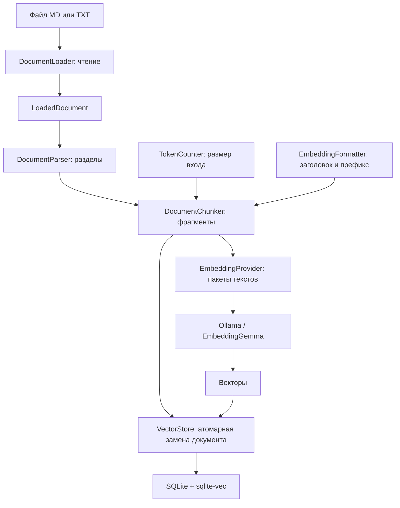
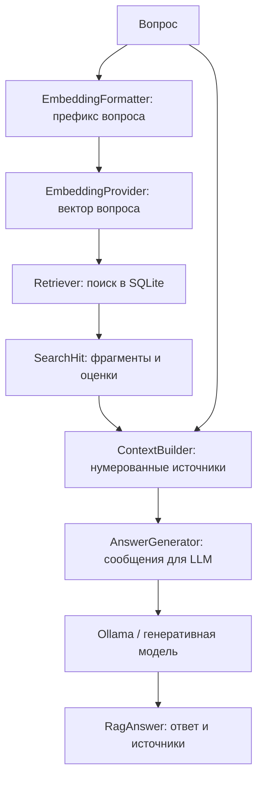

# Local RAG

[English](README.md) | Русский

Приложение загружает Markdown и TXT, находит подходящие фрагменты и отвечает на вопросы по ним. Всё вычисляется на твоём компьютере: **Ollama + EmbeddingGemma** создаёт эмбеддинги, **Tokenizers.js** считает токены, **SQLite + sqlite-vec** хранит индекс, а отдельная LLM в Ollama пишет ответ.

Это учебный CLI-проект на TypeScript. В нём можно менять реализацию каждого этапа через TypeScript-интерфейсы. Имя пакета и папки проекта — `local-rag`, отображаемое название — **Local RAG**. Сообщения CLI, примеры документов и ответы LLM по умолчанию используют английский язык.

## Содержание

- [Быстрый запуск](#быстрый-запуск)
- [Команды](#команды)
- [Как устроен RAG](#как-устроен-rag)
- [Интерфейсы между этапами](#интерфейсы-между-этапами)
- [Как заменить компонент](#как-заменить-компонент)
- [Конфигурация](#конфигурация)
- [Локальные данные](#локальные-данные)
- [Структура проекта](#структура-проекта)
- [Разработка и проверки](#разработка-и-проверки)
- [Зависимости и инструменты](#зависимости-и-инструменты)
- [Что хранится в Git](#что-хранится-в-git)
- [Ограничения и ошибки](#ограничения-и-ошибки)

## Быстрый запуск

Нужны **Node.js 24+** и установленная [Ollama](https://ollama.com/download). Открой приложение Ollama. При запуске через терминал выполни `ollama serve` в отдельном окне.

В каталоге проекта:

```bash
yarn install --immutable
cp .env.example .env
yarn setup
ollama pull qwen3.5:4b
yarn check
yarn ingest examples/company.md
yarn ingest examples/it.txt
yarn search "How far in advance must employees on probation request leave?"
yarn ask "How far in advance must employees on probation request leave?"
```

Если `.env` уже существует, отредактируй его вместо копирования поверх. Примеры документов и ответы LLM по умолчанию — на английском языке. Учебные правила вымышленные: в ответе на этот вопрос должно быть **21 календарный день**.

`yarn setup` скачивает два файла токенизатора из зафиксированной ревизии Hugging Face и загружает EmbeddingGemma в Ollama, если её ещё нет. Модель для ответов скачивается отдельно. После подготовки `ingest`, `search` и `ask` используют локальные файлы и локальный сервис; интернет для них не нужен. Ollama должна оставаться запущенной.

Yarn **4.18.1** закреплён в проекте, его исполняемый файл хранится в `.yarn/releases`. Можно использовать Corepack: `corepack yarn install --immutable`. Если команды `yarn` и Corepack нет, выполняй команды через комплектный файл, например:

```bash
node .yarn/releases/yarn-4.18.1.cjs install --immutable
node .yarn/releases/yarn-4.18.1.cjs setup
```

## Команды

| Команда                           | Что делает                                                                             |
| --------------------------------- | -------------------------------------------------------------------------------------- |
| `yarn setup`                      | Подготавливает токенизатор и EmbeddingGemma; может скачивать файлы                     |
| `yarn check`                      | Проверяет SQLite в памяти, файлы токенизатора, обе модели и настоящий embedding-запрос |
| `yarn check --storage-only`       | Проверяет только SQLite и расширение; Ollama не нужна                                  |
| `yarn ingest "путь/документ.md"`  | Загружает или полностью заменяет один документ в индексе                               |
| `yarn ingest "путь/документ.txt"` | То же для обычного текста                                                              |
| `yarn search "вопрос"`            | Показывает ближайшие фрагменты и их оценки близости                                    |
| `yarn ask "вопрос"`               | Находит фрагменты и получает ответ LLM со ссылками                                     |
| `yarn cli --help`                 | Показывает подсказку                                                                   |

`check` не индексирует документы и не проверяет качество ответов LLM. Он использует временную SQLite-базу в памяти; совместимость рабочего индекса проверяется при `ingest`, `search` и `ask`.

## Как устроен RAG

RAG состоит из двух процессов: **индексации документов** и **ответа на вопрос**. Индексация готовит данные заранее. При вопросе приложение сначала ищет подходящие тексты, затем передаёт их генеративной модели.

### Индексация



#### 1. Загрузка файла

`FileDocumentLoader` в `src/documents/file-loader.ts` принимает путь, проверяет расширение и размер, читает UTF-8 и нормализует переносы строк. Поддерживаются `.md`, `.markdown` и `.txt`.

На выходе `LoadedDocument`: идентификатор, физический путь, имя, формат, текст и хеш содержимого. Идентификатор — хеш физического пути, поэтому повторная загрузка обновляет тот же документ. Изменение пути создаёт другой документ.

#### 2. Разбор на разделы

`TextDocumentParser` в `src/documents/parser.ts` использует Markdown AST из remark. Он сохраняет иерархию заголовков и не принимает `#` внутри блока кода за заголовок. Вступление без заголовка тоже сохраняется. TXT трактуется как обычный текст одного раздела.

Определения ссылок сохраняются: нужные определения добавляются к использующему их разделу, а неиспользованные — в раздел «References».

На выходе массив `DocumentSection`: название раздела, его текст и диапазон строк. На этом этапе ещё нет векторов и запросов к Ollama.

#### 3. Токенизатор и чанкинг

Токен — единица текста, с которой работает модель: слово, часть слова, знак или другой фрагмент. Количество символов и количество токенов различаются.

`HuggingFaceTokenCounter` в `src/tokenization/huggingface-tokenizer.ts` использует **@huggingface/tokenizers** и файлы токенизатора EmbeddingGemma. Это локальные вычисления без embedding-весов и ONNX Runtime. Метод `count(text)` возвращает число токенов со специальными токенами, заданными в конфигурации токенизатора.

`TokenDocumentChunker` в `src/chunking/token-chunker.ts` не использует сторонний splitter. Разделы не объединяются. Модуль подбирает границу по токенам полного подготовленного входа, предпочитает абзац, строку или пробел и сохраняет Unicode-графемы через `Intl.Segmenter`. Длины отдельных слов не складываются: для BPE-токенизации такая сумма может быть неточной. Помимо токенов ограничивается размер текста в символах.

На выходе `DocumentChunk`: исходный текст фрагмента, название раздела, диапазон строк раздела, готовый `embeddingInput`, количество токенов и порядковый номер. Вход EmbeddingGemma ограничен 2048 токенами; приложение оставляет небольшой запас и запрещает молчаливое обрезание через `truncate: false`.

Перекрытие помогает сохранить смысл на границе фрагментов, но увеличивает количество векторов. Размер ограничивается токенами и символами. Перекрытие не превышает заданное число токенов и половину предыдущего фрагмента, поэтому обработка всегда продвигается вперёд. Для крупных таблиц и кода стоит заменить реализацию чанкинга.

#### 4. Формат входа embedding-модели

`EmbeddingGemmaFormatter` в `src/embeddings/formatter.ts` формирует разные входы:

```text
Документ: title: company.md — Company policy → Leave | text: Chunk text...
Вопрос:   task: search result | query: Who approves leave?
```

Это [формат, рекомендованный Google для поиска](https://ai.google.dev/gemma/docs/embeddinggemma/model_card#prompt-instructions). Заголовок и префикс входят в токеновый бюджет. Исходный `body` сохраняется отдельно: в контекст LLM передаётся он, а не служебный embedding-префикс.

Токенизатор приложения считает длину входа для чанкинга и не создаёт векторы. Ollama повторно токенизирует вход перед эмбеддингами; провайдер сверяет её подсчёт с локальным. Для генерации ответа Ollama использует токенизатор выбранной LLM.

Форматирование вынесено в отдельный интерфейс, потому что при смене модели могут измениться префиксы. Его `signature` входит в подпись индекса: новая реализация должна сообщать новую подпись, если меняет подготовку входа.

#### 5. Эмбеддинги

`OllamaEmbeddingProvider` в `src/embeddings/ollama-embedder.ts` вызывает официальный метод `client.embed()`. Под капотом библиотека обращается по HTTP к уже запущенному локальному сервису Ollama.

EmbeddingGemma превращает подготовленный текст в вектор из 768 чисел. Вопрос и документы проходят через одну embedding-модель; их типы различаются только форматом входа. Векторизатор проверяет лимит входа, число результатов, размерность, конечность значений и ненулевой вектор. Он проверяет семейство и embedding-возможность модели, сверяет пакетный подсчёт токенов с Ollama и проверяет digest до и после запроса. При обнаруженной смене модели операция завершается ошибкой до записи документа.

Фрагменты отправляются пакетами, размер пакета настраивается. Сначала вычисляются все векторы документа, затем начинается запись в SQLite. При ошибке модели старый документ остаётся в базе.

#### 6. Хранение

`SqliteVectorStore` в `src/storage/sqlite-store.ts` реализует `VectorStore`. Он хранит:

| Таблица         | Данные                                                 |
| --------------- | ------------------------------------------------------ |
| `documents`     | Идентификатор, путь, имя и версия документа            |
| `chunks`        | Исходные тексты, embedding-входы, разделы и метаданные |
| `chunk_vectors` | Векторы float32 для поиска по cosine distance          |
| `rag_meta`      | Подпись embedding-конфигурации и размерность           |

В одной транзакции удаляются старые фрагменты документа и добавляются новые. Ошибка SQL вызывает rollback. Повторная загрузка не накапливает дубликаты. Чужая SQLite-база не изменяется, включая режим журнала. Поиск открывает рабочий индекс в режиме read-only; пустой существующий файл не инициализируется при чтении.

Подпись индекса включает имя и digest модели Ollama, размерность, ревизию и хеш файлов токенизатора, формат входов и лимит модели. При запуске очередной команды несовместимый индекс отклоняется. Изменение LLM для ответов не требует перестроения embedding-индекса.

### Поиск и ответ



#### 7. Поиск

`VectorRetriever` в `src/retrieval/vector-retriever.ts` форматирует вопрос, получает embedding-вектор и вызывает поиск хранилища. Результат — `SearchHit[]`: тексты, документы, разделы, distance и score.

`score = 1 - cosine_distance`. Больший score означает большую близость векторов; это не вероятность правильного ответа. `TOP_K` ограничивает число результатов, `SCORE_THRESHOLD` при необходимости отсекает слишком далёкие фрагменты. Без заданного порога поиск возвращает ближайшие фрагменты, даже если ответа в них нет.

Отдельный интерфейс `Retriever` позволяет впоследствии добавить гибридный поиск или reranker, сохранив интерфейс основного RAG-сервиса.

#### 8. Сборка контекста

`SourcesContextBuilder` в `src/generation/context-builder.ts` присваивает фрагментам номера `[1]`, `[2]` и формирует два сообщения: инструкцию и вопрос с источниками в JSON. Материалы обозначены как данные, а не команды.

В бюджет символов входят инструкция, вопрос и источники. Фрагменты добавляются целиком; слишком большой фрагмент пропускается. Если ни один не помещается, приложение выдаёт ошибку с советом изменить размер фрагментов или контекста.

Это ограничение по символам, а не точный токеновый бюджет генеративной модели. У LLM собственный токенизатор. Для точного контроля её входа можно заменить `ContextBuilder`, добавив соответствующий счётчик токенов.

#### 9. Генерация ответа

`OllamaAnswerGenerator` в `src/generation/ollama-generator.ts` вызывает `client.chat()`. По умолчанию это Qwen `qwen3.5:4b`; EmbeddingGemma используется только для векторов.

Ответ должен опираться на источники. Пустой ответ, ссылка на номер, которого нет в контексте, и ответ с `done_reason=length` отклоняются. Последний признак означает, что генерация была обрезана по лимиту. Эти проверки не доказывают фактическую правильность текста. Если поиск не дал результатов, `RagService` сообщает о недостатке данных без вызова LLM.

## Интерфейсы между этапами

Полные определения находятся в `src/core/contracts.ts`.

| Интерфейс            | Вход → выход                                                | Текущая реализация        |
| -------------------- | ----------------------------------------------------------- | ------------------------- |
| `DocumentLoader`     | Путь → `Promise<LoadedDocument>`                            | `FileDocumentLoader`      |
| `DocumentParser`     | `LoadedDocument` → `DocumentSection[]`                      | `TextDocumentParser`      |
| `TokenCounter`       | Текст → количество токенов                                  | `HuggingFaceTokenCounter` |
| `EmbeddingFormatter` | Документ/вопрос → подготовленный текст; подпись формата     | `EmbeddingGemmaFormatter` |
| `DocumentChunker`    | Документ и разделы → `Promise<DocumentChunk[]>`             | `TokenDocumentChunker`    |
| `EmbeddingProvider`  | Массив входов → `Promise<EmbeddingBatch>`; описание модели  | `OllamaEmbeddingProvider` |
| `VectorStore`        | Документ с векторами → запись; вектор → найденные фрагменты | `SqliteVectorStore`       |
| `Retriever`          | Вопрос → `Promise<SearchHit[]>`                             | `VectorRetriever`         |
| `ContextBuilder`     | Вопрос и фрагменты → `AnswerContext`                        | `SourcesContextBuilder`   |
| `AnswerGenerator`    | `AnswerContext` → `Promise<string>`                         | `OllamaAnswerGenerator`   |

`RagService` в `src/core/rag-service.ts` задаёт порядок действий. Он получает реализации через `RagStages` и не импортирует Ollama, Tokenizers.js или SQLite. `VectorStore.stats()` описывает только общие счётчики; SQLite-диагностика находится в адаптере. Закрытие хранилища может быть асинхронным и ожидается сервисом. `src/application.ts` — единственное место сборки компонентов. Сборка выполняется обычной функцией: все выбранные реализации видны в одном месте.

## Как заменить компонент

1. Реализуй соответствующий интерфейс из `contracts.ts`.
2. Подключи реализацию в `application.ts` вместо текущей.
3. Добавь общие настройки в `config.ts`, параметры технологии — в `runtime-config.ts` или её адаптер, параметры конкретной модели — в её профиль.
4. Проверь контракт тестом: правильность входов/выходов и передачу ошибок.
5. При смене embedding-модели, её токенизатора или форматирования используй новую базу и повторно загрузи документы.

Например, новый embedding-провайдер должен вернуть столько же векторов, сколько входных строк, и сообщить идентичность своей модели через `describe()`. Новое хранилище должно реализовать поиск и атомарную замену документа. Другой парсер возвращает те же `DocumentSection[]`; остальным этапам не требуется знать его библиотеку.

### Почему выбраны эти компоненты

Выбран один локальный сервис Ollama для двух моделей, потому что он уже используется в проекте. Локальный токенизатор остаётся в Node.js для чанкинга. SQLite сохраняет запуск без отдельного сервера базы. TypeScript-интерфейсы отделяют этапы, а обычная функция сборки сохраняет проект понятным.

Альтернативы: Transformers.js позволял индексировать при выключенной Ollama, но добавлял ONNX-движок; node-llama-cpp потребовал бы управления GGUF-моделью внутри Node.js. Эти варианты можно вернуть отдельными адаптерами при необходимости. Текущая схема требует работающей Ollama для индексации, поиска и ответов.

## Конфигурация

Конфигурация разделена по ответственности. **`src/config.ts`** содержит общие настройки RAG без SDK, имён моделей и репозиториев. **`src/runtime-config.ts`** собирает параметры выбранных адаптеров. **`src/model-profiles/embeddinggemma.ts`** содержит формат входов и проверенные артефакты конкретной модели. `.env.example` — пример переопределений, а `.env` — локальные значения. CLI-скрипты загружают `.env` стандартным механизмом Node.js до запуска приложения. Реализации этапов получают нужную часть конфигурации через аргументы.

| Переменная                      | По умолчанию                               | Назначение                                               |
| ------------------------------- | ------------------------------------------ | -------------------------------------------------------- |
| `SQLITE_PATH`                   | `data/rag.sqlite`                          | Файл embedding-индекса                                   |
| `OLLAMA_URL`                    | `http://127.0.0.1:11434`                   | Общий адрес сервиса для эмбеддингов и LLM                |
| `OLLAMA_EMBEDDING_MODEL`        | `embeddinggemma`                           | Модель векторизации                                      |
| `OLLAMA_MODEL`                  | `qwen3.5:4b`                               | Модель генерации ответа                                  |
| `EMBEDDING_DIMENSIONS`          | `768`                                      | Число координат вектора                                  |
| `EMBEDDING_MAX_TOKENS`          | `2048`                                     | Лимит полного входа embedding-модели                     |
| `EMBEDDING_BATCH_SIZE`          | `16`                                       | Число фрагментов в одном embedding-запросе               |
| `TOKENIZER_CACHE`               | `.cache/tokenizers`                        | Корень кеша файлов токенизатора                          |
| Источник токенизатора в профиле | `onnx-community/embeddinggemma-300m-ONNX`  | Репозиторий файлов токенизатора                          |
| Ревизия источника в профиле     | `5090578d9565bb06545b4552f76e6bc2c93e4a66` | Зафиксированная ревизия этих файлов                      |
| `CHUNK_TOKENS`                  | `256`                                      | Целевой максимум фрагмента с заголовком и префиксом      |
| `CHUNK_MAX_CHARACTERS`          | `4096`                                     | Максимальный размер текста фрагмента в символах          |
| `CHUNK_OVERLAP`                 | `32`                                       | Максимум перекрытия; также ограничен половиной фрагмента |
| `TOP_K`                         | `5`                                        | Максимальное количество найденных фрагментов             |
| `SCORE_THRESHOLD`               | Не задан                                   | Минимальная cosine similarity, от -1 до 1                |
| `CONTEXT_MAX_CHARACTERS`        | `12000`                                    | Максимум символов сообщений LLM с источниками            |
| `LLM_CONTEXT_TOKENS`            | `8192`                                     | Размер контекстного окна, запрашиваемый у Ollama для LLM |
| `LLM_MAX_OUTPUT_TOKENS`         | `512`                                      | Максимальная длина ответа LLM                            |
| `OLLAMA_TIMEOUT_MS`             | `300000`                                   | Таймаут одного запроса к Ollama                          |
| `OLLAMA_KEEP_ALIVE`             | `5m`                                       | Время удержания моделей в памяти после запроса           |

Относительные пути считаются от рабочего каталога запуска. Запускай команды из корня проекта. Кеш разделён по репозиторию и ревизии: файлы разных токенизаторов не смешиваются.

Лимит файла и инструкция ответа находятся в общем конфиге. Префиксы EmbeddingGemma, запас 8 токенов, SHA коммита и контрольные суммы JSON находятся в профиле модели. Температура, thinking, адрес Ollama и путь SQLite относятся к настройкам адаптеров. Источник и ревизия токенизатора больше не переопределяются отдельно через `.env`: новая модель должна получать согласованный профиль.

Загрузчик конфигурации отклоняет превышение лимитов профиля: для EmbeddingGemma это 2048 токенов и не более 768 координат. Не устанавливай `EMBEDDING_MAX_TOKENS` выше реального лимита модели. Для EmbeddingGemma используется 2048. Не все embedding-модели поддерживают выбор размерности. При выборе другой модели нужно также согласовать её токенизатор и `EmbeddingFormatter`.

### Файлы токенизатора и SHA

`5090578d9565bb06545b4552f76e6bc2c93e4a66` — SHA коммита репозитория с файлами токенизатора. Закрепление позволяет повторно получить ту же версию, вместо меняющейся ветки `main`. Для каждого JSON дополнительно закреплены размер и SHA-256 содержимого; они проверяются при скачивании и чтении. Повреждённый кеш отвергается, а `yarn setup` восстанавливает его.

`onnx-community/...-ONNX` — имя публичного репозитория экспорта. Из него используются только `tokenizer.json` и `tokenizer_config.json`, без весов `.onnx`. Исходный репозиторий Google требует принятия условий доступа; публичный экспорт выбран, чтобы подготовка токенизатора не требовала HF-токена. Это выбор происхождения данных, а не вычислительного движка.

## Локальные данные

База по умолчанию — `data/rag.sqlite`, кеш токенизатора — `.cache/tokenizers/`. Оба каталога создаются автоматически и исключены из Git. Старый индекс MiniLM несовместим с EmbeddingGemma: документы нужно загрузить заново.

### Что скачивается

| Компонент                                 | Где находится             | Кто использует                 |
| ----------------------------------------- | ------------------------- | ------------------------------ |
| EmbeddingGemma                            | Хранилище моделей Ollama  | Сервис Ollama, вызов `embed()` |
| Генеративная модель                       | Хранилище моделей Ollama  | Сервис Ollama, вызов `chat()`  |
| `tokenizer.json`, `tokenizer_config.json` | Кеш проекта               | Tokenizers.js внутри Node.js   |
| npm-зависимости                           | `node_modules` и кеш Yarn | TypeScript-приложение          |

Имя репозитория токенизатора содержит `ONNX`, но его ONNX-веса не скачиваются. В проекте нет Transformers.js и ONNX Runtime. После подготовки локальные команды не скачивают модель или токенизатор автоматически; скачивание выполняет `setup`.

### Когда перестраивать индекс

| Изменение                                                               | Действие                                                 |
| ----------------------------------------------------------------------- | -------------------------------------------------------- |
| Текст документа                                                         | Повторить `ingest` этого файла                           |
| Размер/перекрытие фрагментов или парсер                                 | Повторить `ingest` нужных файлов                         |
| Embedding-модель, её digest, размерность, токенизатор или формат входов | Новый `SQLITE_PATH` и повторная загрузка всех документов |
| LLM, её температура, окно или размер ответа                             | Перестроение embedding-индекса не требуется              |
| `TOP_K`, порог или сборка контекста                                     | Перестроение не требуется                                |

Самый простой способ создать новый индекс:

```bash
SQLITE_PATH=./data/new-index.sqlite yarn ingest examples/company.md
SQLITE_PATH=./data/new-index.sqlite yarn search "Who approves leave?"
```

Затем закрепи выбранный путь в `.env`. Старая база не перезаписывается при несовпадении подписи модели. Идентификатор документа зависит от физического пути: после перемещения папки проекта пересоздай учебный индекс, чтобы в нём не оставались записи со старыми путями.

### Резервная копия

Во время работы SQLite в режиме WAL рядом с базой могут существовать файлы `-wal` и `-shm`. Для простой копии останови команды, работающие с базой, и скопируй закрытый файл. Для копирования во время записи нужен согласованный SQLite backup.

## Структура проекта

```text
src/
  cli.ts                 команды и вывод в терминал
  config.ts              общие настройки RAG
  runtime-config.ts      настройки выбранных адаптеров
  model-profiles/        модель, формат входов и проверенные файлы токенизатора
  application.ts         сборка реализаций в приложение
  core/                  интерфейсы, типы данных и порядок этапов
  documents/             загрузка MD/TXT и разбор разделов
  tokenization/          подготовка файлов и локальный подсчёт токенов
  chunking/              разбиение разделов
  embeddings/            формат входов и вызов embedding-модели
  storage/               SQLite и векторный поиск
  retrieval/             вопрос → вектор → найденные фрагменты
  generation/            контекст и вызов LLM
  ollama/                общий клиент Ollama
examples/                учебные документы
tests/                   быстрые тесты без Ollama
scripts/                 проверки с настоящими моделями
README.md                документация на английском
README.ru.md             документация на русском
.env.example             пример локальных настроек
.yarn/releases/          закреплённый Yarn
.yarn/patches/            исправления деклараций типов зависимости
```

## Разработка и проверки

```bash
yarn validate
yarn test:integration
yarn test:llm
```

`validate` выполняет проверку типов, ESLint, Prettier, быстрые тесты и сборку. Интернет и Ollama для неё не нужны. Две проверки настоящих моделей требуют `yarn setup` и запущенную Ollama; недоступность сервиса считается ошибкой.

Для отдельных действий есть `yarn typecheck`, `yarn lint`, `yarn lint:fix`, `yarn format`, `yarn format:check`, `yarn test` и `yarn build`.

После сборки можно запускать JavaScript:

```bash
yarn build
yarn start search "Who approves leave?"
```

## Зависимости и инструменты

Каждая прямая зависимость используется кодом приложения или инструментами разработки.

| Зависимость                                 | Для чего нужна                                                   |
| ------------------------------------------- | ---------------------------------------------------------------- |
| `@huggingface/tokenizers`                   | Локальный подсчёт токенов EmbeddingGemma                         |
| `ollama`                                    | Официальный клиент: `embed()` и `chat()`                         |
| `unified`, `remark-parse`                   | Разбор Markdown в дерево разделов                                |
| `sqlite-vec`                                | Векторный поиск в SQLite; сам SQLite предоставляет `node:sqlite` |
| `typescript`, `@types/node`                 | Проверка типов и сборка с типами Node.js                         |
| `tsx`                                       | Запуск TypeScript CLI и тестов без предварительной сборки        |
| `eslint`, `@eslint/js`, `typescript-eslint` | Проверка JavaScript/TypeScript по `eslint.config.mjs`            |
| `prettier`                                  | Форматирование по `.prettierrc.json`                             |

### Версии и воспроизводимость

Зависимости закреплены точными версиями в `package.json`, транзитивные версии — в `yarn.lock`. Используется Yarn 4.18.1 из `.yarn/releases`. `.gitattributes` отмечает его готовый исполняемый файл как бинарный, чтобы сохранить исходные байты и показывать изменения компактно. Настройка `npmMinimalAgeGate: 1440` сохраняет 24-часовое ожидание новых npm-пакетов при обновлении.

TypeScript 6.0.3 выбран ради совместимости с закреплённым typescript-eslint 8.71.1. Перед обновлением проверяй поддержку новой версии TypeScript парсером ESLint и запускай `yarn validate`.

`.yarnrc.yml` содержит настройки Yarn 4. `.yarnrc` перенаправляет команду старого Yarn 1 на комплектный Yarn 4: оба файла нужны для запуска через разные установленные версии Yarn.

Для Tokenizers.js 0.2.0 сохранён патч в `.yarn/patches`: он добавляет `.js` к относительным ESM-импортам в `.d.ts`. Это исправляет разрешение типов в NodeNext, не меняя исполняемый код или токенизацию. `skipLibCheck` сам по себе может скрыть неразрешённые декларации и ослабить проверку типов. Коммить патч вместе с `package.json` и `yarn.lock`. При обновлении библиотеки проверь, исправлены ли её декларации, и убери патч, когда он станет не нужен.

## Что хранится в Git

В репозиторий входят исходники, тесты, примеры, обе версии README, конфигурация инструментов, `.env.example`, `package.json`, `yarn.lock`, закреплённый Yarn и патч Tokenizers.js.

`.gitignore` исключает локальное состояние и восстанавливаемые файлы:

| Файлы и каталоги                                                              | Причина                                                                                   |
| ----------------------------------------------------------------------------- | ----------------------------------------------------------------------------------------- |
| `node_modules/`, `.yarn/` кроме `releases/` и `patches/`                      | Зависимости, кеш и состояние установки восстанавливаются через `yarn install --immutable` |
| `dist/`, `coverage/`, `*.tsbuildinfo`                                         | Результаты сборки, покрытия тестов и кеш TypeScript                                       |
| `.env`, `.env.*` кроме `.env.example`                                         | Локальные адреса, пути и возможные секреты                                                |
| `.cache/`, `data/`, `*.sqlite` и журналы SQLite                               | Файлы токенизатора и рабочие индексы подготавливаются локально                            |
| `.idea/`                                                                      | Личные настройки WebStorm                                                                 |
| `.DS_Store`, `Thumbs.db`, `*.log`, `*.log.*`, `*.tmp`, `*.swp`, `*.swo`, `*~` | Системные файлы, журналы и временные файлы                                                |

Рабочая база, `.env` и кеши остаются на компьютере. Для переноса базы используй резервную копию, а на другом компьютере установи зависимости и выполни `yarn setup`. Примеры в `examples/` — входные данные для обучения и проверок приложения.

## Ограничения и ошибки

Повторный `ingest` одного физического пути заменяет его фрагменты и векторы в транзакции. Удалённые части исчезают, другие документы сохраняются. Переименование файла создаёт другой идентификатор документа; автоматического удаления старого документа здесь нет.

Документы ограничены 5 МиБ. PDF/OCR, гибридный поиск и reranker не реализованы. Таблицы и блоки кода могут разбиваться внутри. Диапазон строк относится ко всему исходному разделу, а не к точной позиции каждого фрагмента.

Близость векторов не является вероятностью правильного ответа. LLM может ошибаться даже при наличии подходящих источников. Контекст LLM ограничивается символами; точный подсчёт токенов её модели в приложении пока не выполняется.

При ошибке соединения проверь запуск Ollama и `OLLAMA_URL`; при отсутствии модели — `ollama pull <имя>`. При отсутствии файлов токенизатора выполни `yarn setup`. Для несовместимого индекса укажи новый `SQLITE_PATH` и повтори `ingest`.
