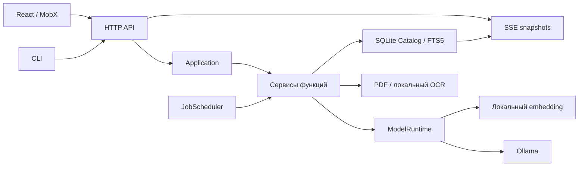

# Архитектура Local RAG

Приложение — универсальная локальная библиотека документов с поиском и чатом. Правила изменения проекта находятся в [AGENTS.md](../AGENTS.md). До первого релиза поддерживается только текущий API и формат данных; преобразования старых схем и адаптеры отсутствуют.

## Границы системы

Два Yarn workspace имеют собственные зависимости, конфигурацию TypeScript, сборки и тесты. Клиент работает только через HTTP/SSE. Сервер не импортирует клиентскую реализацию. Корневой lockfile фиксирует единый набор зависимостей для воспроизводимой установки.



## Структура

```text
client/
  src/
    app/                 создание приложения, provider, навигация
    features/            экраны, диалоги и хранилища отдельных функций
      auth/              сессия, вход, первый запуск, аккаунт
      chat/              ветки диалогов, черновик, сообщения
      documents/         библиотека, загрузка, версии, источники
      knowledge-bases/   выбор базы и управление доступом
      jobs/              состояния заданий, ограниченные SSE-соединения
      admin/             ленивое подключение административных экранов
      users/ quality/ sync/ backups/ settings/ operations/
    shared/              API, генерируемые DTO, UI, hooks, permissions, styles
  scripts/               production gateway и сжатие assets
  deploy/                nginx, Dockerfile, служба клиента
  dist/                  генерируемая браузерная сборка
  tests/
server/
  src/
    app/                 сборка и жизненный цикл процесса
    application/         композиция сервисов, контекст, планировщик, порты
    contracts/           публичные DTO и поля команд API
    domain/              внутренние сущности
    features/            самостоятельные сервисы функций
      identity/ collections/ documents/ search/ chat/ jobs/
      quality/ setup/ settings/ sync/ backup/ operations/
    infrastructure/      SQLite, файлы, модели, извлечение, токенизация
    interfaces/          HTTP, SSE, CLI
    config/ shared/      конфигурация, ошибки, валидация, хеширование
  scripts/               подготовка PDF/OCR, launcher, проверка с реальными моделями
  deploy/                Dockerfile, systemd и launchd API
  data/                  данные по умолчанию, не исходники
  .cache/ .venv/         локальные модели/PDF runtime
  dist/                  генерируемый серверный JavaScript
  tests/
tooling/                 общие native TypeScript launchers и генератор DTO
compose.yaml             композиция отдельных client/server deployments
docs/                   API, разработка, эксплуатация, проверка
```

`Application` создаёт сервисы и регистрирует команды, отслеживает запросы и обслуживание. Прикладная логика находится в сервисах функций. `DataContext` предоставляет текущий каталог, авторизацию, конфигурацию и порт моделей; его смена при первом выборе каталога не требует пересоздания всех сервисов. `RuntimeState` содержит только состояние текущего процесса: выполняющиеся задания, отмену, транспортные метрики и блокировку обслуживания.

## Решения и последствия

### Единый сервер с функциональными модулями

Для автономной установки выбран один серверный процесс с одним writer SQLite. Разделение на микросервисы потребовало бы нескольких хранилищ, транзакций между ними и дополнительной эксплуатации. Функциональные сервисы позволяют независимо менять чат, документы, авторизацию и резервное копирование. Отдельные процессы сервера не должны писать в один каталог; writer lock проверяется до старта.

### Клиентские хранилища по функциям

`ApplicationStore` создаёт `SessionStore`, `ChatStore`, `KnowledgeBaseStore` и `JobStreamStore` и хранит навигацию/уведомления. Хранилища передаются через React provider; модульного singleton нет. Административные страницы загружаются лениво. Выбор базы для поиска документов не меняет выбор базы в чате. Ответы, пришедшие после выхода или смены диалога, не восстанавливают закрытое состояние пользователя.

### Один публичный контракт

`server/src/contracts/public.ts` определяет сущности, состояния заданий, имена и допустимые поля команд. `yarn contracts:generate` создаёт `client/src/shared/api/contracts.generated.ts`, и `server/src/contracts/format.generated.ts` с подписью формата; `yarn contracts:check` проверяет совпадение в CI. Подпись схемы включает DDL и текущий контракт: несовместимость определяется по содержимому, а не только номеру версии. Клиент не зависит от Node и серверных SDK. Неизвестные поля команд отклоняются; старые параметры не преобразуются и не сохраняются.

### Один поисковый конвейер

`SearchService` объединяет семантическую близость и FTS5 с точным сопоставлением идентификаторов. Значимые символы в кодах сохраняются. Поиск ограничивается опубликованной активной версией доступного документа, базой знаний и личными вложениями текущего диалога. Исторические версии доступны отдельно для чтения, сравнения и восстановления.

Специализированные поля производителя, семейства, модели оборудования, редакции инструкции, языка, типа, серийного диапазона, даты и «действующей версии» удалены из UI, API, хранения, фильтрации и промпта. Редакции документа представлены реальными неизменяемыми версиями загрузки и временем создания. Язык ответа определяется вопросом. Настройки модели генерации и языка OCR остаются настройками обработки.

### Хранилище и резервные копии

Оригиналы, страницы, фрагменты, векторы, пользователи, сессии, история, задания и эффективная конфигурация находятся в одном SQLite каталоге. Метаданные оригиналов отделены от блоков по 64 КиБ. Каждая операция чтения до 64 КиБ затрагивает максимум два соседних блока; большой HTTP Range стримится такими порциями без материализации всего BLOB. SHA-256 и последовательность блоков проверяются при backup/restore. Векторы хранятся нормализованным Float32 BLOB; JSON-декодирования вектора для каждого поиска нет. Это делает backup API SQLite согласованной копией всего состояния. Новая пустая база создаётся с идентификатором приложения и единственной актуальной схемой. Несовместимая база отклоняется до записи; несовместимая копия не восстанавливается. Миграций прежних форматов нет.

При восстановлении сервер блокирует новые действия, завершает/отменяет выполняющуюся работу, создаёт согласованный rollback-снимок и восстанавливает через SQLite backup. Сессии отзываются, незавершённые задания помечаются interrupted. Завершённые результаты не запускаются заново. Обычные операции CLI используют HTTP работающего сервера. Offline restore и recovery открывают каталог под эксклюзивной блокировкой; локальные check-тесты используют отдельную временную БД.

Поисковый индекс и сохранённые цитаты имеют разные сроки жизни. `chunks` содержит текущие поисковые фрагменты; `source_fragments` сохраняет неизменяемый текст использованной цитаты с документом, версией, страницей и разделом. Поэтому переиндексация той же версии не ломает старые ответы. `source_usage` индексирует ссылки из сообщений, оценок и результатов проверки; SQL-триггеры поддерживают их транзакционно. Очистка не удаляет фрагмент, пока на него ссылаются сохранённые данные. Окончательное удаление документа удаляет оригиналы, версии, оба вида фрагментов, векторы, кеши и производные результаты, включая ожидаемые факты контрольных запусков.

Составные изменения пользователя, сессий, прав и эпох кеша выполняются в одной транзакции. Вложенные операции используют SQLite savepoints. Ошибка записи откатывает всё изменение; отдельный регрессионный тест инъецирует `DISK_FULL` между сменой пользователя и отзывом сессий.

### Доступ и ресурсы

Сервер повторно читает пользователя и ACL при каждом запросе, перед выдачей задания/SSE, при выборе источников и выдаче кеша. Изменения документов, прав и настроек увеличивают epoch и очищают кеш. Отдельный access epoch сообщает клиенту об изменении прав; открытые окна со старыми данными закрываются, история и списки обновляются. В контекст модели попадают только разрешённые источники. Интерфейсные permissions нужны для отображения кнопок, сервер остаётся авторитетом.

Планировщик выделяет независимые полосы для ответа, документов и оценки. Query embedding и массовая индексация используют отдельные ONNX runners. OCR запускается только на страницах без пригодного текста и имеет отдельные ограничения времени/памяти. Страницы OCR с предупреждениями требуют явной проверки. SSE передаёт актуальные snapshots, использует heartbeat и ограничивает соединения, размер события и буфер медленного клиента.

Markdown больше 256 КиБ разбирается в отдельном процессе Node с пределом heap 256 МиБ, таймаутом и отменой. Извлечённый текст и число фрагментов ограничены до inference; чанкинг периодически возвращает управление event loop. PDF-процесс и его OCR-потомки завершаются вместе при отмене, ошибке лимита или таймауте; собственные временные файлы удаляются в `finally`.

## Проверка границ

`server/tests/architecture.test.ts` проверяет изоляцию workspace, отсутствие Node-зависимостей на клиенте, зависимостей domain от реализации, циклов runtime-импортов и расхождения публичных команд с регистрацией сервисов. Функциональные тесты проверяют поведение независимо от расположения файлов; live-сценарий использует настоящие embedding, Ollama, PDF и OCR. См. [REQUIREMENTS.md](REQUIREMENTS.md).

## Независимые deployments

API не обслуживает клиентские assets и не знает каталог client/dist. Клиентская production-сборка развёртывается отдельно: nginx либо небольшой gateway на стандартной библиотеке Node. Оба проксируют только публичный HTTP API/SSE. Клиент остаётся доступным при остановке API и показывает состояние подключения. Общая команда start — supervisor двух процессов, Compose — композиция двух образов.

Относительные данные и модели по умолчанию принадлежат server/; production-пути задаются окружением вне исходников. Настройки различаются по владельцу: физические адреса/каталоги/CPU относятся к deployment, семантические параметры обработки — к данным и воспроизводимости индекса. Восстановление сохраняет вторые и привязывает первые к новой машине.

## Ограничение стоимости операций

Списки документов, пользователей, диалогов, контрольных вопросов и результатов проверок используют SQL-пагинацию. Чат читает последние 40 сообщений выбранной ветки, старые сообщения подгружает назад, варианты — отдельным списком. Экспорт всех веток стримит согласованный read-only SQLite snapshot, проверяя актуальные права перед каждым сообщением. Медленное скачивание не может неограниченно удерживать snapshot и блокировать обслуживание.

Кеш поиска проверяется до чтения корпуса и inference, но после актуальной авторизации. Некешированный поиск объединяет FTS-кандидатов с ограниченной heap семантических кандидатов, фильтрует ACL до LIMIT и декодирует тексты только финальных кандидатов. Векторный LRU ограничен 32 МиБ, SQL-кеш — 1000 записями/64 МиБ, вопросный embedding — 128 записями. Сканирование больших наборов отдаёт управление I/O.

Token-события объединяются при записи в транзакции с интервалом 100 мс. Отмена сохраняет последний разрешённый текст; удаление источника или диалога не позволяет finally-блоку воскресить удалённые данные. Запуск, восстановление и очистка выбирают только незавершённые записи, не декодируя всю завершённую историю. Хеширование локальных синхронизируемых файлов потоковое и асинхронное.

## Клиентский UI

Навигация хранится в URL, а не в одном компоненте экрана. Auth, чат, документы и семь разделов администрирования используют общие кнопки, формы, таблицы, модальные окна, статусы и токены дизайна. Общие стили разделены на базу, layout, административные компоненты, документы, чат, auth, overlays и responsive. Административные экраны загружаются лениво.

Серверные снимки в MobX shallow/ref сохраняют неизменяемость и избегают глубокого преобразования длинных ответов. Асинхронные ответы защищены счётчиками запросов и эпохой сессии. SSE имеет общий для вкладок origin пул из четырёх соединений через Web Locks; одно место резервируется для чата. Освобождение блокировки следует отмене/закрытию вкладки. Без Web Locks действует более консервативный локальный лимит; серверный предел соединений остаётся обязательным. Смена диалога не отменяет наблюдение индексации. Формы сохраняют введённые значения при ошибке, показывают код/diagnostic, переводят фокус к ошибке, а конфликты ревизий требуют перечитать актуальные данные. Временное состояние кнопки не теряет фокус и не допускает повторного запуска действия.

На телефоне меню исключено из tab-порядка в закрытом состоянии; открытое меню удерживает фокус, Escape закрывает его и возвращает фокус. Нативные dialog обеспечивают фокус и Escape. Markdown рендерится через React без raw HTML, сценариев и внешних изображений; ссылки используют allowlist. Источники в обычном тексте, списках и таблицах открывают конкретную версию/страницу/фрагмент.

## Оставшиеся ограничения архитектуры

Один процесс/writer SQLite — намеренная граница автономной установки, горизонтального масштабирования и совместного каталога нескольких серверов нет. Семантический поиск перебирает разрешённые векторы; для существенно большего корпуса потребуется измерение и отдельное решение по ANN, а не скрытая замена метрики вероятностью. Обработка PDF/OCR и генерация зависят от подготовленных локальных моделей и ресурсов машины. Docker и службы требуют запуска в целевом окружении; результаты локальных проверок не заменяют такую приёмку.

Справочники: [конфигурация](CONFIGURATION.md), [CLI](CLI.md), [проверки и измерения](VERIFICATION.md).
