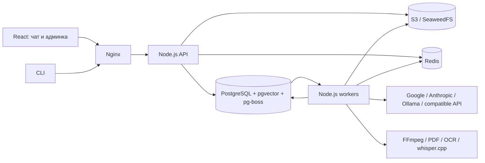

# Архитектура SaaS

## Компоненты

API, workers and CLI use one application contract. The browser imports generated types, never server internals. PostgreSQL is the source of truth; external AI calls run outside business transactions. Queue admission and the application job are committed together through the pg-boss SQL adapter.

`application/application.ts` validates action fields and dispatches to services. Knowledge-base list/grant/mutation policy lives in `features/knowledge-bases/knowledge-base-service.ts`; document counts are batched in one tenant-scoped query. Rename/save/delete use the shared access transaction lock and revisions. Retention/GC lives in `features/operations/retention-service.ts`, invoked by the maintenance queue. HTTP and CLI do not duplicate these policies.

Production Python/Swift helpers are `server/resources/extraction`; compiled and source code resolve them from the server root. Root `tooling/server` owns launch/build/preparation. Shared demo inputs live in `examples/knowledge-base`, outside application code and runtime storage. Current UI and the proposed redesign are documented separately in [usage](USAGE.md) and [admin UX](ADMIN-UX.md).

## Компания и права

A global identity has separate membership, role and groups in each company. Tenant ID comes from the authenticated membership, not an unchecked request header. Every tenant table has forced row security. App role is neither superuser nor BYPASSRLS; schema ownership belongs to the initializer. The operator manages companies and approved model connections. Company administrators manage members, grants, knowledge bases and settings, and can lower spending limits. Only the operator can raise resource entitlements or edit provider/model/pricing profiles. Personal attachments and conversations remain owner-only, including for company administrators.

ACL filtering happens before vector/full-text candidates are limited. File downloads, SSE, citations and historical answers recheck current access. Redis keys include tenant, user, groups, revisions, index and model. Company switching clears client state and rejects stale responses. Invitations are single-use, seven-day tokens stored as hashes; existing identities must prove their password. There is no public first-operator registration.

## Загрузка и индексация

1. Client hashes the file and creates an authenticated upload session with declared length and SHA-256.
2. Binary multipart chunks go through our API to private S3. Offset and part metadata survive API restart; the same upload session can resume.
3. Finalization verifies actual object size and checksum, then atomically creates document/version/assets/job metadata. Incomplete files never become searchable.
4. A document worker extracts text, renders PDF pages, normalizes images and segments audio/video. A reviewer checks the result before explicit publication.
5. Published immutable source fragments receive provenance IDs. Embeddings and FTS chunks belong to a specific index/model space. Search combines vector, full-text and technical-code matches with reciprocal rank fusion.
6. Replacing an embedding model builds a separate index. Activation rejects a build if the corpus changed. Old source IDs remain valid for historical citations.

Originals and derived media have immutable tenant-prefixed keys. Database rows carry checksum, size, MIME, document/version and owner scope. Files never use a public bucket. Deletion queues physical objects for GC and invalidates retrieval/history access immediately.

## Запрос и очередь

The client submits conversation, parent revision, question, attachments, selected profile and idempotency key. A retry with the same key returns the accepted job; different content with the same key is rejected. The API returns after the database commit, then a worker retrieves authorized sources, builds bounded model context, streams deltas to saved PostgreSQL snapshots and completes the job. SSE carries snapshots and monotonic update IDs; reconnect does not rerun generation.

pg-boss supplies persistent delivery, heartbeat recovery, group concurrency, retry backoff and a dead-letter queue. Our job row records visible status, model/settings snapshots, cancellation, error diagnostic and attempt token. Global, tenant and model limits are separate. Indexing, answers, evaluation and maintenance run in independent processes/queues. Processing limits additionally isolate FFmpeg/OCR/Whisper CPU usage.

An attempt token prevents stale work from committing after cancellation/deletion. Safe capacity/rate failures can retry. A crash during a reserved external AI call is marked uncertain on recovery: the app cannot promise exactly-once billing by an external provider. Manual retry creates a new recorded job. Accepted jobs remain visible even when they fail or require review. Request rejection before acceptance returns 429/503 and creates no phantom job.

Workers use a one-second polling backstop while LISTEN/NOTIFY is active. PostgreSQL notifications can coalesce; without a bounded backstop a single-slot maintenance worker can wait 30 seconds between ready jobs even when its previous job completed. Polling without notifications remains 0.5 seconds. These are pickup intervals, not job completion deadlines.

## Провайдеры и стоимость

AI ports accept typed text/image/audio/video/PDF input. Adapters implement streaming generation, embeddings and health; Whisper has a local transcription adapter. Each role has a profile with capabilities, dimensions, endpoint, secret reference, concurrency, timeouts, RPM/TPM and prices. Unsupported combinations fail explicitly. Operator endpoint allowlisting prevents company-controlled arbitrary URLs. API credentials live in the encrypted global PostgreSQL vault; only the master key remains deployment configuration. Profiles store an alias, and saved credential values are never returned to the browser.

Google supports native multimodal generation/embeddings when the configured models do. Anthropic supports text/image/PDF generation. Ollama and compatible endpoints support text/image generation and text embeddings subject to the actual model. Profiles expose only implemented generation, embedding and transcription roles.

Before cloud calls the application reserves a conservative budget using the profile context limit and output cap, then settles provider-reported usage. Uncertain calls retain their reservation. Prices are configurable, not live invoices; quotas protect the application estimate, while provider billing remains authoritative. Missing prices or credentials block paid calls. Model IDs are configurable defaults and must be verified against the provider account.

## Кеширование и эксплуатация

Redis stores exact answer, embedding and retrieval caches with bounded values/TTL. It never stores the only copy of accepted jobs or permissions. In-process single-flight and short Redis locks reduce simultaneous duplicate embedding calls; distributed cache locks are an optimization, not an exactly-once guarantee. Content/access/settings changes advance revision keys. Anthropic ephemeral prompt caching is requested when enabled; Google implicit cache and local runtime KV reuse are provider-managed and not guaranteed hits. No application-managed transferable KV cache exists.

PostgreSQL leases and rate windows remain effective during Redis failure. Nginx proxies SSE without buffering, limits uploads and serves immutable client assets. Health and diagnostics report dependency availability; optional OpenTelemetry exports HTTP/PostgreSQL spans without document text or enhanced SQL parameter capture. Structured errors use diagnostic IDs without provider response bodies.

Tenant snapshots are signed, checksummed current-format exports in S3 with a consistent PostgreSQL snapshot and copied immutable objects. Restoration blocks that tenant, fences jobs and replaces only its rows. Global accounts/passwords and other companies are not overwritten. An offline operator snapshot additionally saves PostgreSQL and the stopped local S3 volume for whole-installation disaster recovery. The private deployment .env must be backed up separately.

HTTP memory bounds: at most 16 simultaneous buffered request bodies per API process; SSE leases cap 128 streams per deployment, 32 per company and 8 per user. Completed jobs remain saved when a transport connection is rejected or reconnects.

Tenant restore preserves the current usage ledger, operator resource/spending entitlements and model catalog. It cannot rewind provider expenses or restore obsolete prices/connections. Model calls use current approved prices and rate limits even when an index retains its original semantic model snapshot; changing prices alone never requires reindexing.

## Реестр API-ключей

Platform-wide ai_credentials and credential_audits are separate from tenant resource tables. Values use AES-256-GCM with a random 96-bit nonce, a 128-bit tag and authenticated alias/provider; HKDF derives the encryption key from APP_ENCRYPTION_KEY with a domain distinct from backup signatures. The database never stores the master key or plaintext. Every environment requires a valid master key. Public results expose only metadata; even operators cannot read a saved value.

The application authorizes secrets.* using the current operator identity. Writes and model reference updates share a platform transaction lock. Global reference counts use a narrow SECURITY DEFINER count function because tenant model tables enforce RLS. Delete checks every company; global revisions prevent stale writes after alias recreation. Credential audit excludes values and stays outside tenant audit/backup/restore. Full installation dumps include ciphertext, requiring the separately protected master key.

AIService resolves the enabled credential from PostgreSQL after waiting for provider capacity, immediately before constructing an adapter. There is no process/Redis plaintext cache or invalidation broadcast. API and independent workers observe rotations on the next call; in-flight calls may finish. Provider errors discard response bodies. Credentialed endpoints require HTTPS in production; deployment endpoints remain allowlisted.

## Чтение материалов и UI

DocumentCatalog reads permission-filtered metadata in a fixed number of queries; generated version metadata and a recent-job index avoid parsing large JSON bodies for every list row. DocumentReader authorizes selected versions and projects metadata/page summaries separately from bounded text windows and literal search results. UTF-16 range corrections preserve the remainder and use the document revision lock. The chat consumes indexed attachment fragments rather than entire source pages. Binary-media limits do not remove their available text representations.

The client shares a navigation scope/tab registry and unsaved-form registry. Dirty tracking stores identifiers only. Model catalog/editor, knowledge workspace and document find are feature modules; generated contracts remain the only server/client type boundary. Ad hoc search cancellation follows the request signal; accepted queue work has its own durable lifetime.

DocumentRevisions creates an independent correction candidate from a ready version. S3 server-side copies preserve source checksums; deterministic derivative identifiers allow retry without duplicate assets. Storage quota and document revision are checked transactionally, worker writes are attempt-fenced, and current edit access is rechecked before completion. The active index/version is untouched until explicit publication. No OCR/ASR/generation runs during copying.
